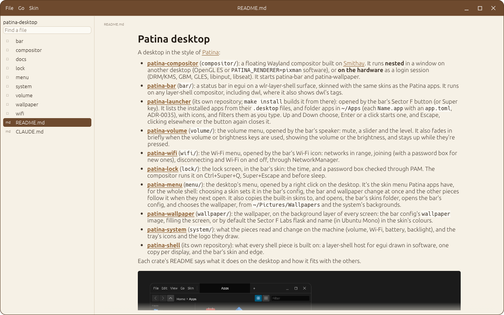
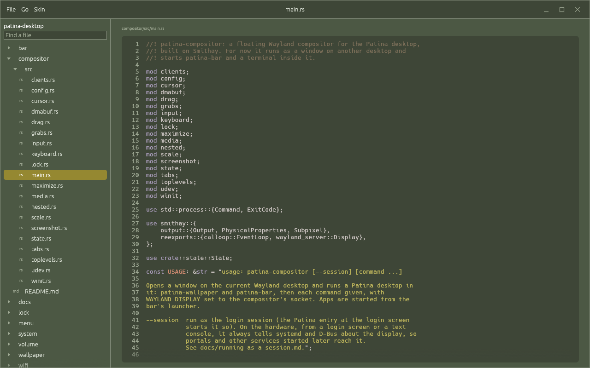
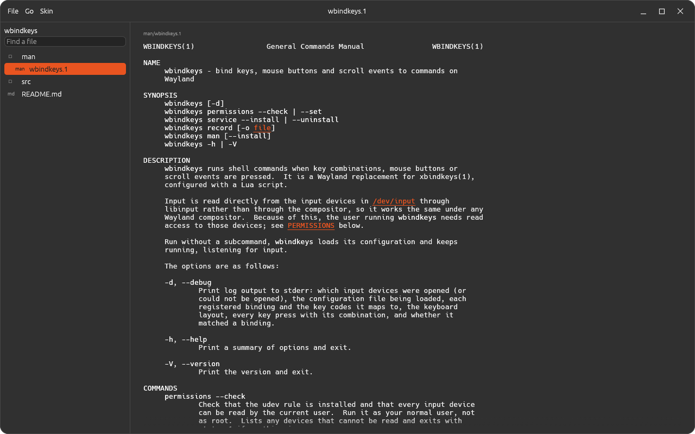

# Reader

A [Patina](https://github.com/Sector-F-Labs/patina) reader for a project's documentation and code.
Point it at a folder, such as the Patina desktop's, and browse its markdown, shown exactly as
Notebook shows it, its man pages, and its Rust source, highlighted. It only reads: nothing can be
changed. It's meant to become Patina's help viewer, opened when you choose Help in a Patina app.



- **Markdown** (`.md`) through Patina's markdown widget in read-only mode: headings, lists, tasks,
  quotes, tables, highlighted code blocks and images, with no markdown syntax on screen. Text can
  be selected and copied. A link to another file in the project opens it here, a folder opens
  its README, a web link the browser, anything else its usual app.
- **Rust** (`.rs`) highlighted as code blocks are, with line numbers, on the skin's code
  background.
- **Man pages** (`.1` to `.9`, gzipped or not) formatted by the system's man tools (mandoc, else
  man-db), with man's bold and underline. Go → Man Page opens any installed one by name (`ls`,
  `printf(3)`).
- The project as a tree, with only what Reader shows in it (no `target/`, `.git` or hidden
  folders), READMEs first; a filter to find a file by name (Ctrl+F, Enter opens the first).
- Back and forward (Alt+Left and Alt+Right, or the mouse's side buttons), Reload (Ctrl+R), Open
  Project (Ctrl+O, through the desktop's file chooser), and the last project and file read open
  again next time.
- Patina skins, starting in Notebook's.

```sh
reader ~/Src/com/sectorflabs/patina-desktop        # a project
reader docs/adr/0001-build-on-patina.md            # a file, in its repository
```

| Rust in Steam Classic | A man page in Dark Orange |
|---|---|
|  |  |

## Install

```sh
make install      # ~/.local/bin/reader, its launcher and icon
```

It depends on Patina's develop branch from GitHub, for its markdown widget.

## Develop

```sh
make check        # tests and clippy
make run          # read this repository
make screenshot   # docs/screenshot-markdown.png, in a scratch config
```

Decisions are in [docs/adr](docs/adr/README.md).
