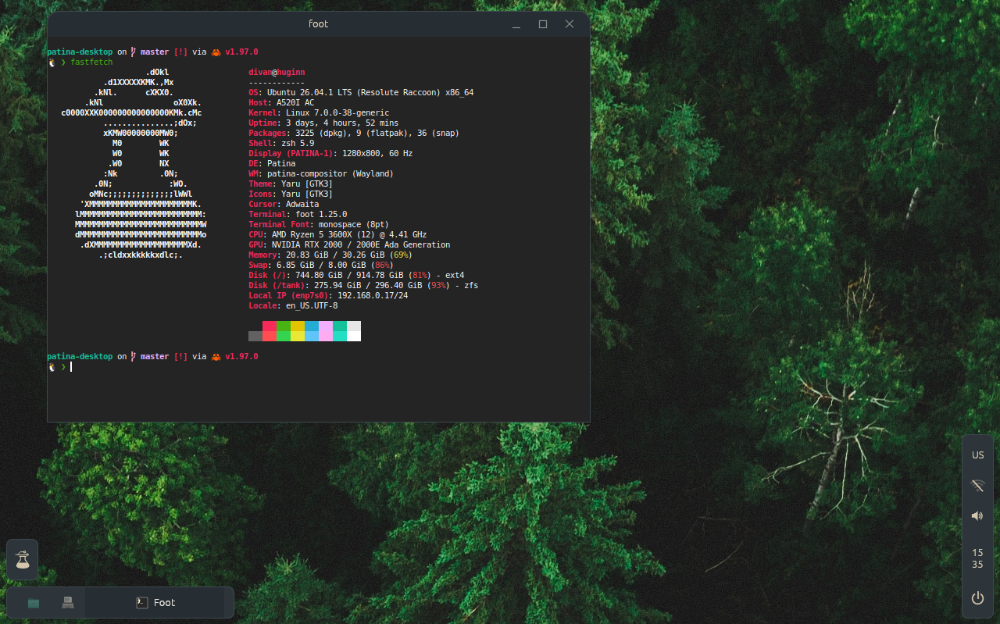

# Patina desktop

A desktop in the style of [Patina](https://github.com/Sector-F-Labs/patina):

- **[patina-compositor](compositor/README.md)** (`compositor/`): a floating Wayland compositor built on
  [Smithay](https://github.com/Smithay/smithay). It runs **nested** in a window on another
  desktop (OpenGL ES or `PATINA_RENDERER=pixman` software), or **on the hardware** as a login
  session (DRM/KMS, GBM, GLES, libinput, libseat). It starts patina-bar and patina-wallpaper.
- **[patina-session](session/README.md)** (`session/`): the login session. It runs the compositor
  and starts it again when it restarts (Ctrl+Alt+Shift+Backspace) or crashes, so neither means
  logging in again.
- **[patina-bar](bar/README.md)** (`bar/`): a status bar in egui on a wlr-layer-shell surface, skinned with the
  same skins as the Patina apps. It runs on any layer-shell compositor, including dwl, where it
  also shows dwl's tags.
- **[patina-launcher](https://github.com/Sector-F-Labs/patina-launcher)** (its own repository; `make install` builds it from there): opened by the bar's Sector F button (or Super key). It lists
  the installed apps from their `.desktop` files, and folder apps in `~/Apps` (each
  `Name.app` with an `app.toml`, ADR-0035), with icons, and filters them as you type. Up
  and Down choose, Enter or a click starts one, and Escape, clicking elsewhere or the button
  again closes it.
- **[patina-volume](volume/README.md)** (`volume/`): the volume menu, opened by the bar's speaker: mute, a slider
  and the level. It also fades in briefly when the volume or brightness keys are used, showing
  the volume or the brightness, and stays up while they're pressed.
- **[patina-screenshot](screenshot/README.md)** (`screenshot/`): what the Print key opens, a pill
  at the bottom of the screen like dictation's: the screen, the focused window, or a selection
  dragged out with the pointer, which the compositor then takes; or recording the screen or a
  selection to `~/Videos/Screen Recordings`. Also what an app asking to share the screen (OBS,
  a browser) may see, through xdg-desktop-portal-wlr.
- **[patina-wifi](wifi/README.md)** (`wifi/`): the Wi-Fi menu, opened by the bar's Wi-Fi icon: networks in range,
  joining (with a password box for new ones), disconnecting and Wi-Fi on and off, through
  NetworkManager.
- **[patina-power](power/README.md)** (`power/`): the power menu, opened by the button after the
  bar's clock: Lock, Log Out, Restart and Shut Down, each but Lock asking first.
- **[patina-lock](lock/README.md)** (`lock/`): the lock screen, in the bar's skin: the time, and a password box
  checked through PAM. The compositor runs it on Ctrl+Super+Q, Super+Escape and before sleep.
- **[patina-dictate](dictate/README.md)** (`dictate/`): speech to text on the machine, with Whisper
  (ADR-0070). For now a command that records until Enter and prints what was said; it'll be
  what a held key dictates into any field with.
- **[patina-menu](menu/README.md)** (`menu/`): the desktop's menu, opened by a right click on the desktop. It's the
  skin menu Patina apps have, for the whole shell: choosing a skin sets it in the bar's config,
  the bar and wallpaper change at once and the other pieces follow it when they next open. It
  also copies the built-in skins to, and opens, the bar's skins folder, opens the bar's config,
  and chooses the wallpaper, from `~/Pictures/Wallpapers` and the system's backgrounds.
- **[patina-wallpaper](wallpaper/README.md)** (`wallpaper/`): the wallpaper, on the background layer of every screen: the
  bar config's `wallpaper` image, filling the screen, or by default the Sector F Labs flask and
  name (in Ubuntu Mono) in the skin's colours.
- **[patina-processes](processes/README.md)** (`processes/`): the process manager, on Ctrl+Shift+Escape, a key no
  config can take: the apps with their windows, and every process, with what each costs the CPU,
  memory and disks; ending, killing and pausing them; and graphs of the CPU, memory, disks and
  network over the last minute.
- **[patina-system](system/README.md)** (`system/`): what the pieces read and change on the
  machine (volume, Wi-Fi, battery, backlight), and the tray's icons and the logo they draw.
- **[patina-shell](https://github.com/Sector-F-Labs/patina-shell)** (its own repository): what
  every shell piece is built on: a layer-shell host for egui drawn in software, one copy per
  display, and the bar's skin and edge.

Each crate's README says what it does on the desktop and how it fits with the others. Each
program has a man page, installed by `make install`; `man patina-desktop` is the overview: the
pieces, the keys, where settings are kept, and restarting and recovering.



## Running

```sh
make run                          # the compositor in a window on this desktop, with the bar
patina-compositor foot firefox    # and any clients to start besides the bar
dwl -s patina-bar                 # the bar alone, on dwl, with dwl's tags
patina-session --session          # as a login session (from a text console or the login screen)
```

**Nested** (on GNOME/sway/etc.): the compositor opens a window; move it with Super+drag.
Windows float and cascade; click to focus and raise.

**On hardware** (text console or login screen via `make install`): one monitor
(internal panel first), GPU via Mesa/NVIDIA, fractional scaling (1.0, 1.5, 2.0), keyboard/mouse/
touchpad via libinput, console switching (Ctrl+Alt+F1–F12), Ctrl+Alt+Backspace to quit, Ctrl+Alt+Shift+Backspace to
restart the desktop without logging out.

Window keys (on hardware; change them in `[keys]` in the compositor's config, applied within a
second, ADR-0069): **Super** or **Super+Space** opens launcher, **Super+1–9** brings tab forward,
**Alt+Tab** / **Alt+Shift+Tab** cycles, **Super+Up/Down** maximise/restore, **Super+Left/Right**
half-screen tile (**Ctrl+Super+K/J/H/L** too), **Super+Shift+arrows** grow/shrink by 1/10 screen,
**Ctrl+Super+Shift+K/J/L/H** resize around centre, drag a maximised/tiled window to restore under pointer, **Super+W** close
window, **Super+Q** quit app, **Super+M** minimise to its tab, **Ctrl+Space** switch keyboard layout, **Super+Shift+R** reload
config, **Super+Shift+3** screenshots the desktop and **Super+Shift+4** the focused window (to
~/Pictures/Screenshots), **Print** or **Super+Shift+5** offers the screen, the window or a
selection, or recording the screen or a selection, brightness/volume keys work with on-screen flash.

## The bar's config

`~/.config/patina-bar/config.toml`, or `patina-bar -c <file>`. Every key is optional:

```toml
position = "bottom"         # or "top"
height = 41                 # as tall as a Patina title bar
skin = "Default"            # a Patina skin, or one in ~/.config/patina-bar/skins
tags = ["1", "2", "3", "4", "5", "6", "7", "8", "9"]
hide_vacant_tags = false
left = ["launcher", "windows", "tags", "layout"]
center = ["title"]
right = ["tray", "clock"]
clock = "%a %-d %b  %H:%M"  # strftime, as in date(1)
launcher = "patina-launcher"  # what the Sector F button runs, through sh(1)
wallpaper = ""              # an image for patina-wallpaper; "" for the Sector F default
```

The modules are `launcher` (the Sector F flask, which runs `launcher` when clicked), `windows`
(the open windows as Patina tabs: a click brings one forward, its cross closes it), `tags`,
`layout`, `title`, `appid`, `clock` and `tray` (a Wi-Fi icon showing the signal, a
speaker showing the volume and, on laptops, the battery; clicks open the Wi-Fi and volume menus, run by
`wifi = "patina-wifi"` and `volume = "patina-volume"`). `windows` needs a compositor with
wlr-foreign-toplevel-management, such as patina-compositor or sway. `tags` and `layout` come
from dwl and show nothing elsewhere. Unknown keys and modules are reported on stderr and skipped.
A broken file falls back to the defaults.

## Compositor config

`~/.config/patina-compositor/config.toml`; every key is optional (ADR-0019). First start writes
it with defaults commented out; edit to change, `Super+Shift+R` reloads. Never rewritten.

```toml
scale = 1.25                 # unset: from the panel's density

[keyboard]
layout = "us,se"             # unset: /etc/default/keyboard
variant = ""
options = ""
repeat_delay = 200           # ms before a held key repeats
repeat_rate = 25             # repeats per second

[touchpad]
tap = true                   # tap to click
natural_scroll = true        # content follows your fingers
speed = 0.0                  # -1.0 (slow) to 1.0 (fast)

[media]
brightness_step = 5          # percent per press of a brightness key
volume_up = "wpctl set-volume -l 1.0 @DEFAULT_AUDIO_SINK@ 5%+"
volume_down = "wpctl set-volume @DEFAULT_AUDIO_SINK@ 5%-"
mute = "wpctl set-mute @DEFAULT_AUDIO_SINK@ toggle"
mic_mute = "wpctl set-mute @DEFAULT_AUDIO_SOURCE@ toggle"
```

`[bindings]` maps key combinations to commands (defaults: Alt+T = teleprinter, Alt+B = firefox).
A custom `[bindings]` replaces defaults. Brightness keys work via logind; volume keys run the
commands above (for PipeWire).

## Not yet

- **Multiple monitors**, hotplug, lid close/open.
- **Virtual desktops / workspaces** (the bar's tags are placeholders until the compositor has them).
- **Minimise** and **fullscreen**.
- **Portals** (xdg-desktop-portal): Flatpak integration; screenshots through the portal. (Screen
  sharing goes through xdg-desktop-portal-wlr, ADR-0092; files through Files' chooser.)
- **Polkit agent** for auth prompts (Software, Disks, etc.).
- **Notification daemon**.
- **GNOME keyring** integration (PAM unlock at login).
- **Autostart** list for apps at login.

## Build

`make` lists the targets:

| Target | |
|---|---|
| `make run` | The compositor in a window on this desktop |
| `make check` | Tests and clippy |
| `make install` | Build, then install for every user into `/usr/local`, with the login screen's session and the lock screen's PAM service; asks doas or sudo ([how](docs/running-as-a-session.md), ADR-0078) |
| `make deploy <host>` | Build here, and install the same on an ssh host through `doas rsync` (needs rsync and doas there), with Teleprinter from `../teleprinter` (else GitHub) as its terminal |
| `make uninstall` | Remove what `make install` put in place |
| `make vm` | The FreeBSD test VM: the compositor in a window on dwl ([bsdt](https://bsdt.divanv.com)) |
| `make vm-restart` | Rebuild in the VM and restart its desktop |
| `make vm-gui` | Open the VM's desktop over VNC |
| `make screenshot` | The VM's desktop to `docs/screenshot.png` |

Building the compositor needs a few system libraries (xkbcommon, pixman, udev, libinput,
libseat, GBM, EGL, libdrm); `make deps` lists the packages. Design decisions are in
[docs/adr](docs/adr/README.md).

## Licence

BSD-3-Clause, like Patina.
