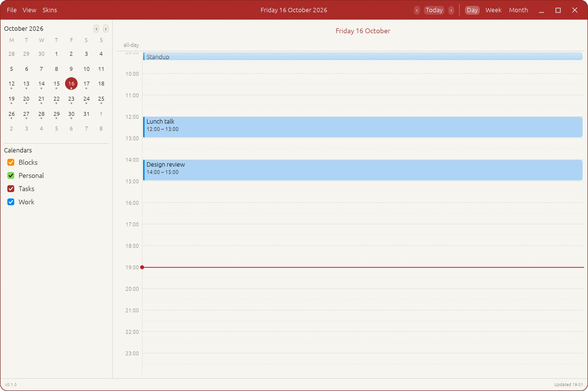
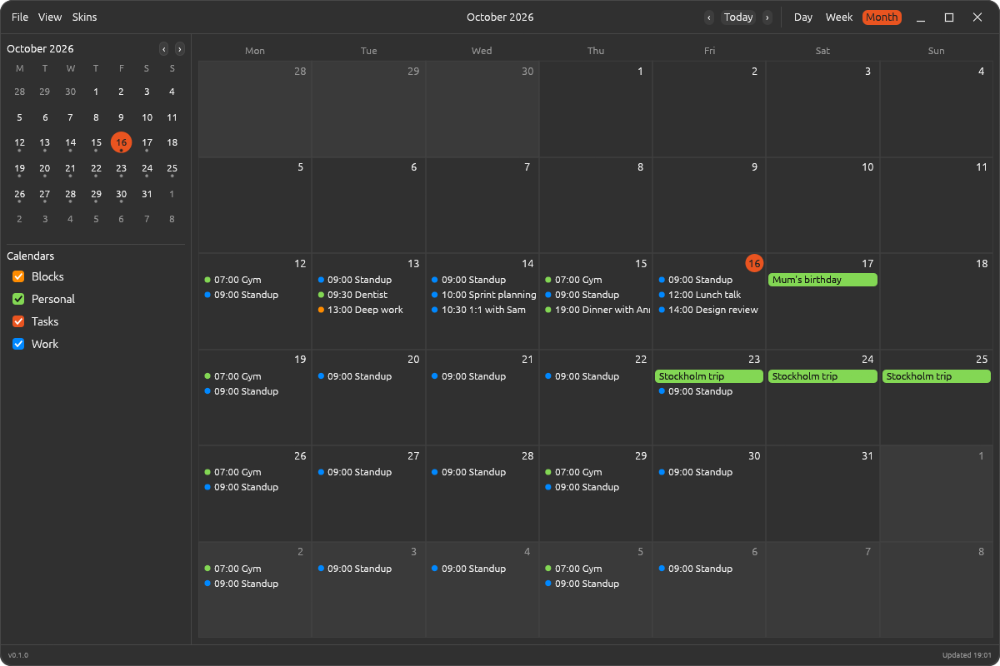

# Calendar


Calendar is a desktop calendar for a CalDAV server, made for [plan](../plan) on urd. It's built
with [egui](https://github.com/emilk/egui) on [Patina](https://github.com/Sector-F-Labs/patina), so
it shares a window frame and skins with Notebook, Photograph and UnAmp.



## Features

- **Views:** day, week and month, with Today and previous/next in the header bar.
- **Calendars in colour:** colours come from the server. Right-click a calendar to change its
  colour, and the change reaches every client. Click a calendar to show or hide it, as in Apple
  Calendar and GNOME Calendar.
- **A mini month** in the sidebar: jump to any date, with dots on days that have events.
- **Events:** add with File → New Event or by double-clicking a time or day, and click one to edit
  or delete it.
  - Repeating events show on every occurrence. Deleting asks whether to delete just this
    occurrence or all of them.
  - Changes keep everything else in the event's file, so events made on the phone survive an edit
    here.
- **Works from a cache:** opens instantly with what it last saw, and syncs in the background
  every five minutes or on Ctrl+R.
- **Its own skin, Calendar:** a deep red title bar (freebsd.org's red) over a paper-white page,
  like the icon, and the starting skin. Patina's other skins (Default, Dark Orange, Notebook,
  Steam Classic) and any skin in `~/.config/calendar/skins/` are in the Skins menu.



## From the command line

Other programs (the Patina desktop's clock) read what's coming up and open the app where they
point:

```bash
calendar --agenda                          # today's events, as JSON
calendar --agenda --from 2026-10-23 --days 7
calendar --open 2026-10-24                 # the window, at that day
calendar --open 2026-10-24 --event <uid>   # and that event's occurrence on it
```

`--agenda` reads the cache, with no window or network, so it's as fresh as the last sync. Each
item has `uid`, `title`, `location`, `calendar`, `color`, `start`, `end` (RFC 3339) and `all_day`.

## Shortcuts

| Keys | Does |
|---|---|
| ← / → (or PgUp / PgDn) | Previous / next day, week or month |
| T (or Ctrl+T) | Today |
| D / W / M (or Ctrl+1 / 2 / 3) | Day / week / month view |
| Ctrl+N | New event |
| Ctrl+R | Refresh from the server |
| Ctrl+Q | Quit |

## Setup

On first run, Calendar asks for the server: `https://plan.divanv.com/` with plan's username and
password. They're saved in `~/.config/calendar/account.toml`, readable only by you. Change them
later in File → Account….

## Build

```sh
make              # list targets
make run          # run with your settings
make dev          # run against a local plan server with made-up calendars
make test         # tests
make live-test    # CalDAV tests against the local plan server
make check        # tests and clippy
make install      # install for your user, with icon and launcher
```

`make dev`, `make live-test` and `make screenshot` start `plan serve` from `../plan` on port 5299,
seeded by `scripts/seed-dev-calendars.py`, and use a scratch config. They never touch your settings
or the real server.

Decisions are recorded in [docs/adr](docs/adr/README.md).

## License

BSD-3-Clause
