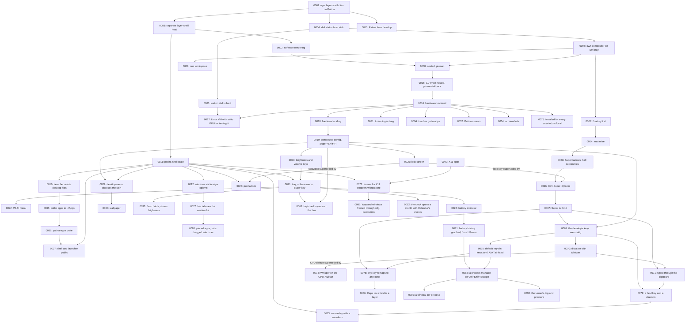

# Architecture Decision Records

This directory holds ADRs for the Patina desktop (patina-compositor and patina-bar) — short records of significant architecture decisions,
written at the time they're made, following Michael Nygard's format as popularized by Martin
Fowler: <https://martinfowler.com/bliki/ArchitectureDecisionRecord.html>.

## When to write one

Write an ADR when a decision is:

- Hard, or expensive, to reverse once other code depends on it.
- Not obvious from reading the code — a "why", not a "what".
- The kind of thing that'll get re-litigated later without a record ("didn't we already decide
  this?").

Small, reversible choices don't need one. Rule of thumb: if you'd want to explain the choice to a
new contributor in a paragraph beyond what the code itself shows, it's ADR-sized.

An ADR is a point-in-time record of *a decision as it was made*, including the options considered
and rejected. It does not get rewritten later — a decision that reverses or replaces an earlier one
gets its own new ADR that supersedes the old one, which stays in place with its status updated.

## Convention

- One file per decision: `NNNN-short-kebab-title.md`, numbered sequentially, zero-padded to 4
  digits. Numbers are never reused, even for a decision that gets reversed.
- Start from [`0000-template.md`](0000-template.md) — copy it, don't write from scratch.
- `Status` is one of: `Proposed`, `Accepted`, `Rejected`, `Deprecated`, or `Superseded by
  ADR-NNNN` (linked to the superseding record).
- Every new ADR gets a row in the index below.
- Keep records short — a paragraph or two per section is normal. An ADR documents a decision and
  its reasoning, not a design document.

The Patina desktop is built on [Patina](https://github.com/Sector-F-Labs/patina). Decisions about the shared
frame, skins and components are recorded in Patina's own ADRs; record here only what this app
decides.

If you're working with Claude Code in this repo, `.claude/skills/adr/SKILL.md` automates the
mechanics of adding one.

## Index

| # | Title | Status |
|---|-------|--------|
| [0001](0001-build-on-patina.md) | Build patina-bar as an egui layer-shell client on Patina | Accepted |
| [0002](0002-software-rendering.md) | Draw egui in software into wl_shm buffers | Proposed |
| [0003](0003-layer-shell-host.md) | Keep the layer-shell host separate from the bar | Proposed |
| [0004](0004-dwl-status-from-stdin.md) | Read dwl's status from stdin | Proposed |
| [0005](0005-test-on-dwl-in-bsdt.md) | Test on dwl in a bsdt FreeBSD VM | Accepted |
| [0006](0006-own-compositor.md) | Build our own compositor on Smithay | Accepted |
| [0007](0007-floating-first.md) | Floating windows first | Accepted |
| [0008](0008-nested-software-backend.md) | Run nested, drawn in software with pixman | Proposed |
| [0009](0009-one-workspace.md) | Keep the compositor and the bar in one cargo workspace | Accepted |
| [0010](0010-launcher-reads-desktop-entries.md) | The launcher lists apps from .desktop files | Accepted; moved with the launcher by [0037](0037-patina-shell-and-the-launcher-are-public.md) |
| [0011](0011-shared-shell-crate.md) | Move the layer-shell host into patina-shell | Proposed |
| [0012](0012-windows-through-foreign-toplevel.md) | The bar learns about windows through wlr-foreign-toplevel-management | Proposed |
| [0013](0013-patina-from-develop.md) | Depend on Patina's develop branch | Accepted |
| [0014](0014-maximise.md) | Maximise fills the work area, and dragging restores | Proposed |
| [0015](0015-gl-when-nested.md) | Render nested with OpenGL ES through winit, keeping pixman as the fallback | Proposed |
| [0016](0016-hardware-backend.md) | Run on the hardware with DRM/KMS, GBM, libinput and libseat | Proposed |
| [0017](0017-linux-vm-for-the-hardware-backend.md) | Test the hardware backend in a Linux VM with a virtio GPU | Proposed |
| [0018](0018-fractional-scaling.md) | Fractional scaling through wp_fractional_scale and wp_viewporter | Accepted |
| [0019](0019-compositor-config-file.md) | A config file for the compositor, reloaded with Super+Shift+R | Accepted |
| [0020](0020-brightness-and-volume-keys.md) | Brightness through logind, volume through configurable commands | Accepted |
| [0021](0021-tray-volume-menu-and-super-key.md) | A tray with a volume menu that doubles as the volume keys' display; Super opens the launcher | Accepted |
| [0022](0022-wifi-menu.md) | A Wi-Fi menu in the tray, talking to NetworkManager over D-Bus | Accepted |
| [0023](0023-half-screen-tiling-keys.md) | Super with the arrows or vim keys maximises, restores and tiles half-screen | Accepted |
| [0024](0024-battery-indicator.md) | A battery indicator in the tray, read from sysfs | Accepted |
| [0025](0025-lock-screen.md) | A lock screen through ext-session-lock, swaylock by default | Accepted; lock key superseded by [0026](0026-lock-with-ctrl-super-q.md), swaylock by [0028](0028-patina-lock.md) |
| [0026](0026-lock-with-ctrl-super-q.md) | Lock with Ctrl+Super+Q, the Mac shortcut; Super+L tiles right again | Accepted |
| [0027](0027-bar-tabs-are-the-window-list.md) | The bar's tabs are the one window list: Alt+Tab and closing follow them | Accepted |
| [0028](0028-patina-lock.md) | Patina's own lock screen, patina-lock, replaces swaylock as the default | Accepted |
| [0029](0029-desktop-menu-chooses-the-skin.md) | A right click on the desktop opens the desktop's menu, which chooses the shell's skin | Accepted |
| [0030](0030-wallpaper.md) | A wallpaper piece, chosen from the desktop's menu, with a Sector F Labs default in the skin's colours | Accepted |
| [0031](0031-three-finger-drag.md) | Three-finger drag, on by default | Accepted |
| [0032](0032-patina-cursors.md) | Patina's own cursors, by name through cursor-shape, and the compositor's during a grab | Accepted |
| [0033](0033-volume-flash-holds-and-shows-brightness.md) | The volume flash holds through repeated keys, and shows brightness too | Accepted |
| [0034](0034-screenshots-with-the-mac-keys.md) | Screenshots with the Mac's keys, taken by the compositor | Accepted |
| [0035](0035-the-launcher-lists-folder-apps.md) | The launcher lists folder apps in ~/Apps | Accepted; moved with the launcher by [0037](0037-patina-shell-and-the-launcher-are-public.md) |
| [0036](0036-folder-apps-come-from-patina-apps.md) | Folder apps are read by patina-apps, a crate shared with Files | Accepted; moved with the launcher by [0037](0037-patina-shell-and-the-launcher-are-public.md) |
| [0037](0037-patina-shell-and-the-launcher-are-public.md) | patina-shell and the launcher are public repositories of their own | Accepted |
| [0038](0038-patina-settings.md) | A Settings app, patina-settings, for settings that need more than a menu | Accepted |
| [0039](0039-night-light.md) | Night Light: the compositor warms the screen through the CRTC's gamma ramp, on the hardware only | Accepted |
| [0040](0040-xwayland.md) | X11 apps run through Xwayland, with the compositor as their window manager | Accepted |
| [0041](0041-fullscreen.md) | Fullscreen windows cover the whole screen, over the bar, while they have the keyboard | Accepted |
| [0042](0042-power-modes-through-power-profiles-daemon.md) | Power modes in Settings, through power-profiles-daemon | Accepted |
| [0043](0043-games-lock-the-pointer.md) | Games lock or confine the pointer, and read the mouse's motion as such | Accepted |
| [0044](0044-smithay-from-a-fork-for-x11-focus.md) | Smithay comes from a fork while 0.7 names the root window as the active one | Accepted |
| [0045](0045-the-compositor-keeps-the-desktops-processes.md) | The compositor keeps the desktop's processes, and Settings shows them | Accepted |
| [0046](0046-patina-session-restarts-the-compositor.md) | patina-session runs the compositor, and starts it again when it restarts or crashes | Accepted |
| [0047](0047-the-screen-turns-off-without-input.md) | The screen turns off after a while without input, unless something is playing | Accepted |
| [0048](0048-a-power-menu-on-the-bar.md) | A power menu at the bar's right end: lock, log out, restart and shut down | Accepted |
| [0049](0049-tiling-by-dragging-decided-over-d-bus.md) | Tiling by dragging, as on Ubuntu, with the decisions open to any app over D-Bus | Proposed; partly superseded by [0053](0053-tiling-decided-by-patina-tiler.md) |
| [0050](0050-window-tabs-show-app-icons.md) | The bar's window tabs show app icons, and Settings has a Bar page | Proposed |
| [0051](0051-gaps.md) | Gaps around tiled windows and a floating bar | Proposed |
| [0052](0052-only-the-app-maximises.md) | Only the app's maximise button maximises; tiling up fills | Proposed |
| [0053](0053-tiling-decided-by-patina-tiler.md) | Tiling is decided by patina-tiler, a process the compositor keeps running | Accepted |
| [0054](0054-drag-the-line-between-tiled-windows.md) | Dragging the line between tiled windows resizes both | Accepted |
| [0055](0055-new-window-from-a-tab.md) | A window's tab opens a new window of its app | Accepted |
| [0056](0056-the-bars-menus-open-in-patina-menu.md) | The bar's menus open in patina-menu | Accepted |
| [0057](0057-the-bars-tooltips-open-in-patina-menu.md) | The bar's tooltips open in patina-menu too | Accepted |
| [0058](0058-patina-raise.md) | patina-raise: focus an app's window, or start it | Accepted |
| [0059](0059-wl-copy-and-focus-after-close.md) | Data-control for the clipboard, and focus back to where it came from | Accepted |
| [0060](0060-patina-raise-matching.md) | patina-raise matches as written, with -i and -p, and by app names | Accepted |
| [0061](0061-tabs-say-app-then-title.md) | The window tabs say the app's name, then the title | Accepted |
| [0062](0062-settings-icon-and-entry.md) | Settings has an icon and a desktop entry | Accepted |
| [0063](0063-split-bar.md) | The bar can be split into its parts, placed anywhere along the edges | Accepted |
| [0064](0064-system-tray.md) | The bar is the system tray, by StatusNotifierItem | Accepted |
| [0065](0065-windows-reopen-where-they-were.md) | Windows reopen where they were, by app id, decided by the tiler | Accepted |
| [0066](0066-the-session-has-default-apps.md) | The session has default apps of its own, in patina-mimeapps.list | Accepted |
| [0067](0067-super-is-cmd.md) | Super is Cmd: the compositor sends Ctrl, or Ctrl+Shift to a terminal | Accepted |
| [0068](0068-keyboard-layouts-on-the-bus.md) | Keyboard layouts on the bus: the bar shows the one in use, Settings manages them | Accepted |
| [0069](0069-the-desktops-keys-are-config.md) | The desktop's own keys are config, by action, applied without a restart | Accepted |
| [0070](0070-dictation-with-whisper-on-the-machine.md) | Dictation with Whisper on the machine, the transcriber built first | Accepted |
| [0071](0071-text-is-typed-through-the-clipboard.md) | Text is typed into the focused window through the clipboard, given back after | Accepted |
| [0072](0072-dictation-is-a-held-key-and-a-daemon.md) | Dictation is a held key in the compositor and a daemon that listens for it | Accepted |
| [0073](0073-dictation-shows-an-overlay.md) | Dictation shows an overlay with the voice's waveform, its own process fed on stdin | Accepted |
| [0074](0074-whisper-runs-on-the-gpu-through-vulkan.md) | Whisper runs on the GPU through Vulkan by default | Accepted |
| [0075](0075-the-default-keys-are-a-toml-file.md) | The default keys are a TOML file built in, and Alt+Tab is fixed | Accepted |
| [0076](0076-any-key-remaps-to-any-other.md) | Any key remaps to any other, sent to the focused window | Accepted |
| [0077](0077-x11-windows-without-a-frame-get-one.md) | X11 windows that draw no frame get one from the compositor, painted with egui | Accepted |
| [0078](0078-installed-for-every-user.md) | The desktop is installed for every user, in /usr/local, as a BSD port is | Accepted |
| [0079](0079-settings-chooses-default-apps.md) | Default apps are chosen in Patina's own defaults.toml, from a Settings page | Accepted |
| [0080](0080-pinned-apps-and-moving-tabs.md) | Apps pin to the bar, and its tabs drag into another order the compositor keeps | Accepted |
| [0081](0081-battery-history-from-upower.md) | The battery's history is graphed in Settings, from what UPower keeps | Accepted |
| [0082](0082-the-clock-opens-a-month-with-calendars-events.md) | The clock opens a month with the day's events, which the Calendar app supplies | Accepted |
| [0083](0083-the-session-reads-the-login-profile.md) | The session takes the environment a login shell sets up | Accepted |
| [0084](0084-minimise-to-the-bars-tabs.md) | Minimised windows leave the space and keep their tabs | Accepted |
| [0085](0085-wayland-windows-get-frames-through-xdg-decoration.md) | Wayland windows that ask for a frame get Patina's, through xdg-decoration | Accepted |
| [0086](0086-caps-lock-held-is-a-layer.md) | Caps Lock held is a layer of keys, tapped Escape | Accepted |
| [0087](0087-settings-sets-light-or-dark.md) | Settings sets light or dark, through GNOME's color-scheme | Accepted |
| [0088](0088-a-process-manager-on-ctrl-shift-escape.md) | A process manager, patina-processes, on Ctrl+Shift+Escape, a key no config can take | Proposed |
| [0089](0089-each-process-opens-a-window-of-its-own.md) | Each process opens a window of its own, with its graphs and details | Proposed |
| [0090](0090-the-kernels-log-and-pressure-say-whats-wrong.md) | The kernel's log and pressure say what's wrong, on the Overview and a Log tab | Proposed |
| [0091](0091-print-offers-the-screen-a-window-or-a-selection.md) | The Print key offers the screen, a window or a selection | Accepted |
| [0092](0092-screen-capture-for-apps-and-recording.md) | Screen capture for apps, through the portal, and the desktop's own recording | Accepted |
| [0093](0093-with-gaps-maximising-fills.md) | With gaps on, an app's maximise fills inside the gaps, unannounced | Accepted |
| [0094](0094-touches-go-to-apps.md) | The touchscreen's touches go to apps as wl_touch, without pointer emulation | Accepted |
| [0095](0095-battery-and-wi-fi-on-freebsd.md) | The battery and Wi-Fi on FreeBSD, behind a trait each | Accepted |
| [0096](0096-the-linux-vm-has-fake-hardware.md) | The Linux test VM has a fake battery and Wi-Fi, made by the kernel | Accepted |
| [0097](0097-linux-regression-tests-drive-the-vm-from-python.md) | Regression tests drive the Linux VM from Python, with uv | Accepted |
| [0098](0098-wifi-menu-signs-in-to-captive-portals.md) | The Wi-Fi menu signs in to captive portals, by NetworkManager's connectivity check | Accepted |
| [0099](0099-one-deb-of-the-desktop-and-its-apps.md) | The desktop ships as one .deb, with the apps it was tested with, pinned in bundle.toml | Accepted |
| [0100](0100-the-desktops-default-skin-is-everforest-dark.md) | The desktop's default skin is Everforest Dark | Accepted |
| [0101](0101-media-controls-in-the-bar.md) | Media controls in the bar, from MPRIS | Accepted |
| [0102](0102-print-takes-the-screen-when-something-is-fullscreen.md) | Print takes the whole screen when something is fullscreen | Accepted |
| [0103](0103-alt-tab-leaves-a-fullscreen-window-with-no-other-tab.md) | Alt+Tab leaves a fullscreen window that has no other tab | Accepted |
| [0104](0104-your-picture-is-dot-face.md) | Your picture is `~/.face`, chosen on Settings' Account page | Accepted |
| [0105](0105-the-desktop-menu-chooses-the-style-not-the-skin.md) | The desktop's menu chooses the style, not the skin | Accepted |
| [0106](0106-files-lives-in-this-repository.md) | Files lives in this repository | Accepted |
| [0107](0107-reader-and-notebook-live-in-this-repository.md) | Reader and Notebook live in this repository | Accepted |
| [0108](0108-the-launcher-lives-in-this-repository.md) | The launcher lives in this repository | Accepted; changes [0037](0037-patina-shell-and-the-launcher-are-public.md) |

## Decision Relationship

## Revisit Triggers

- `ext-foreign-toplevel-list`'s identifiers reach window management: the bar moves windows by
  id, not index ([ADR-0080](0080-pinned-apps-and-moving-tabs.md)).
- Folder apps get their base from Patina OS's runner, or open files and links
  ([ADR-0035](0035-the-launcher-lists-folder-apps.md)).
- A surface that is large or animated draws too slowly on the CPU
  ([ADR-0002](0002-software-rendering.md)).
- The compositor gets workspaces: the bar's tags move from dwl's stdin to the compositor
  ([ADR-0004](0004-dwl-status-from-stdin.md), [ADR-0006](0006-own-compositor.md)).
- Running on real hardware: a DRM/KMS backend ([ADR-0008](0008-nested-software-backend.md)).
