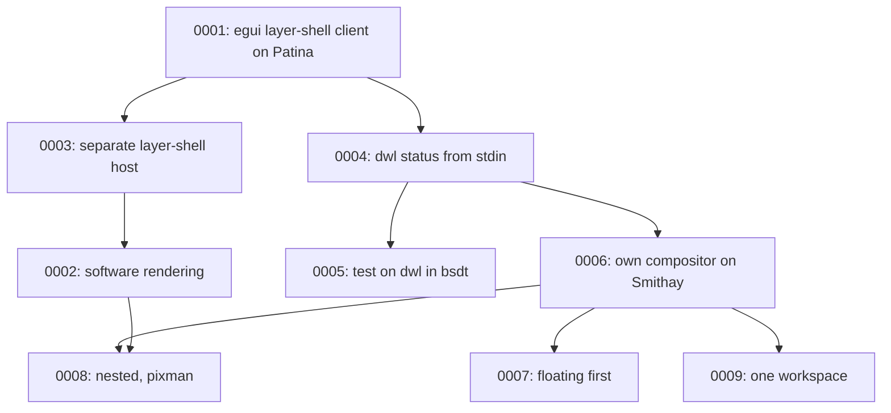

# Architecture Decision Records

This directory holds ADRs for patina-bar — short records of significant architecture decisions,
written at the time they're made, following Michael Nygard's format as popularized by Martin
Fowler: <https://martinfowler.com/bliki/ArchitectureDecisionRecord.html>.

## When to write one

Write an ADR when a decision is:

- Hard, or expensive, to reverse once other code depends on it.
- Not obvious from reading the code — a "why", not a "what".
- The kind of thing that'll get re-litigated later without a record ("didn't we already decide
  this?").

Small, reversible choices don't need one. Rule of thumb: if you'd want to explain the choice to a
new contributor in a paragraph beyond what the code itself shows, it's ADR-sized.

An ADR is a point-in-time record of *a decision as it was made*, including the options considered
and rejected. It does not get rewritten later — a decision that reverses or replaces an earlier one
gets its own new ADR that supersedes the old one, which stays in place with its status updated.

## Convention

- One file per decision: `NNNN-short-kebab-title.md`, numbered sequentially, zero-padded to 4
  digits. Numbers are never reused, even for a decision that gets reversed.
- Start from [`0000-template.md`](0000-template.md) — copy it, don't write from scratch.
- `Status` is one of: `Proposed`, `Accepted`, `Rejected`, `Deprecated`, or `Superseded by
  ADR-NNNN` (linked to the superseding record).
- Every new ADR gets a row in the index below.
- Keep records short — a paragraph or two per section is normal. An ADR documents a decision and
  its reasoning, not a design document.

patina-bar is a [Patina](https://github.com/Sector-F-Labs/patina) app. Decisions about the shared
frame, skins and components are recorded in Patina's own ADRs; record here only what this app
decides.

If you're working with Claude Code in this repo, `.claude/skills/adr/SKILL.md` automates the
mechanics of adding one.

## Index

| # | Title | Status |
|---|-------|--------|
| [0001](0001-build-on-patina.md) | Build patina-bar as an egui layer-shell client on Patina | Accepted |
| [0002](0002-software-rendering.md) | Draw egui in software into wl_shm buffers | Proposed |
| [0003](0003-layer-shell-host.md) | Keep the layer-shell host separate from the bar | Proposed |
| [0004](0004-dwl-status-from-stdin.md) | Read dwl's status from stdin | Proposed |
| [0005](0005-test-on-dwl-in-bsdt.md) | Test on dwl in a bsdt FreeBSD VM | Accepted |
| [0006](0006-own-compositor.md) | Build our own compositor on Smithay | Accepted |
| [0007](0007-floating-first.md) | Floating windows first | Accepted |
| [0008](0008-nested-software-backend.md) | Run nested, drawn in software with pixman | Proposed |
| [0009](0009-one-workspace.md) | Keep the compositor and the bar in one cargo workspace | Accepted |

## Decision Relationship

## Revisit Triggers

- A second layer-shell piece (launcher, notifications) is started: move the host into a shared
  crate ([ADR-0003](0003-layer-shell-host.md)).
- A surface that is large or animated draws too slowly on the CPU
  ([ADR-0002](0002-software-rendering.md)).
- The compositor gets workspaces: the bar's tags move from dwl's stdin to the compositor
  ([ADR-0004](0004-dwl-status-from-stdin.md), [ADR-0006](0006-own-compositor.md)).
- Running on real hardware: a DRM/KMS backend ([ADR-0008](0008-nested-software-backend.md)).
