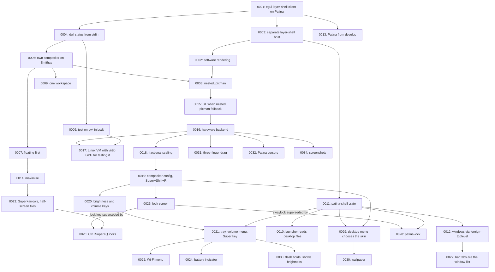

# Architecture Decision Records

This directory holds ADRs for the Patina desktop (patina-compositor and patina-bar) — short records of significant architecture decisions,
written at the time they're made, following Michael Nygard's format as popularized by Martin
Fowler: <https://martinfowler.com/bliki/ArchitectureDecisionRecord.html>.

## When to write one

Write an ADR when a decision is:

- Hard, or expensive, to reverse once other code depends on it.
- Not obvious from reading the code — a "why", not a "what".
- The kind of thing that'll get re-litigated later without a record ("didn't we already decide
  this?").

Small, reversible choices don't need one. Rule of thumb: if you'd want to explain the choice to a
new contributor in a paragraph beyond what the code itself shows, it's ADR-sized.

An ADR is a point-in-time record of *a decision as it was made*, including the options considered
and rejected. It does not get rewritten later — a decision that reverses or replaces an earlier one
gets its own new ADR that supersedes the old one, which stays in place with its status updated.

## Convention

- One file per decision: `NNNN-short-kebab-title.md`, numbered sequentially, zero-padded to 4
  digits. Numbers are never reused, even for a decision that gets reversed.
- Start from [`0000-template.md`](0000-template.md) — copy it, don't write from scratch.
- `Status` is one of: `Proposed`, `Accepted`, `Rejected`, `Deprecated`, or `Superseded by
  ADR-NNNN` (linked to the superseding record).
- Every new ADR gets a row in the index below.
- Keep records short — a paragraph or two per section is normal. An ADR documents a decision and
  its reasoning, not a design document.

The Patina desktop is built on [Patina](https://github.com/Sector-F-Labs/patina). Decisions about the shared
frame, skins and components are recorded in Patina's own ADRs; record here only what this app
decides.

If you're working with Claude Code in this repo, `.claude/skills/adr/SKILL.md` automates the
mechanics of adding one.

## Index

| # | Title | Status |
|---|-------|--------|
| [0001](0001-build-on-patina.md) | Build patina-bar as an egui layer-shell client on Patina | Accepted |
| [0002](0002-software-rendering.md) | Draw egui in software into wl_shm buffers | Proposed |
| [0003](0003-layer-shell-host.md) | Keep the layer-shell host separate from the bar | Proposed |
| [0004](0004-dwl-status-from-stdin.md) | Read dwl's status from stdin | Proposed |
| [0005](0005-test-on-dwl-in-bsdt.md) | Test on dwl in a bsdt FreeBSD VM | Accepted |
| [0006](0006-own-compositor.md) | Build our own compositor on Smithay | Accepted |
| [0007](0007-floating-first.md) | Floating windows first | Accepted |
| [0008](0008-nested-software-backend.md) | Run nested, drawn in software with pixman | Proposed |
| [0009](0009-one-workspace.md) | Keep the compositor and the bar in one cargo workspace | Accepted |
| [0010](0010-launcher-reads-desktop-entries.md) | The launcher lists apps from .desktop files | Accepted |
| [0011](0011-shared-shell-crate.md) | Move the layer-shell host into patina-shell | Proposed |
| [0012](0012-windows-through-foreign-toplevel.md) | The bar learns about windows through wlr-foreign-toplevel-management | Proposed |
| [0013](0013-patina-from-develop.md) | Depend on Patina's develop branch | Accepted |
| [0014](0014-maximise.md) | Maximise fills the work area, and dragging restores | Proposed |
| [0015](0015-gl-when-nested.md) | Render nested with OpenGL ES through winit, keeping pixman as the fallback | Proposed |
| [0016](0016-hardware-backend.md) | Run on the hardware with DRM/KMS, GBM, libinput and libseat | Proposed |
| [0017](0017-linux-vm-for-the-hardware-backend.md) | Test the hardware backend in a Linux VM with a virtio GPU | Proposed |
| [0018](0018-fractional-scaling.md) | Fractional scaling through wp_fractional_scale and wp_viewporter | Accepted |
| [0019](0019-compositor-config-file.md) | A config file for the compositor, reloaded with Super+Shift+R | Accepted |
| [0020](0020-brightness-and-volume-keys.md) | Brightness through logind, volume through configurable commands | Accepted |
| [0021](0021-tray-volume-menu-and-super-key.md) | A tray with a volume menu that doubles as the volume keys' display; Super opens the launcher | Accepted |
| [0022](0022-wifi-menu.md) | A Wi-Fi menu in the tray, talking to NetworkManager over D-Bus | Accepted |
| [0023](0023-half-screen-tiling-keys.md) | Super with the arrows or vim keys maximises, restores and tiles half-screen | Accepted |
| [0024](0024-battery-indicator.md) | A battery indicator in the tray, read from sysfs | Accepted |
| [0025](0025-lock-screen.md) | A lock screen through ext-session-lock, swaylock by default | Accepted; lock key superseded by [0026](0026-lock-with-ctrl-super-q.md), swaylock by [0028](0028-patina-lock.md) |
| [0026](0026-lock-with-ctrl-super-q.md) | Lock with Ctrl+Super+Q, the Mac shortcut; Super+L tiles right again | Accepted |
| [0027](0027-bar-tabs-are-the-window-list.md) | The bar's tabs are the one window list: Alt+Tab and closing follow them | Accepted |
| [0028](0028-patina-lock.md) | Patina's own lock screen, patina-lock, replaces swaylock as the default | Accepted |
| [0029](0029-desktop-menu-chooses-the-skin.md) | A right click on the desktop opens the desktop's menu, which chooses the shell's skin | Accepted |
| [0030](0030-wallpaper.md) | A wallpaper piece, chosen from the desktop's menu, with a Sector F Labs default in the skin's colours | Accepted |
| [0031](0031-three-finger-drag.md) | Three-finger drag, on by default | Accepted |
| [0032](0032-patina-cursors.md) | Patina's own cursors, by name through cursor-shape, and the compositor's during a grab | Accepted |
| [0033](0033-volume-flash-holds-and-shows-brightness.md) | The volume flash holds through repeated keys, and shows brightness too | Accepted |
| [0034](0034-screenshots-with-the-mac-keys.md) | Screenshots with the Mac's keys, taken by the compositor | Accepted |

## Decision Relationship

## Revisit Triggers

- An `~/Applications` folder of AppImages joins the launcher's list
  ([ADR-0010](0010-launcher-reads-desktop-entries.md)).
- A surface that is large or animated draws too slowly on the CPU
  ([ADR-0002](0002-software-rendering.md)).
- The compositor gets workspaces: the bar's tags move from dwl's stdin to the compositor
  ([ADR-0004](0004-dwl-status-from-stdin.md), [ADR-0006](0006-own-compositor.md)).
- Running on real hardware: a DRM/KMS backend ([ADR-0008](0008-nested-software-backend.md)).
