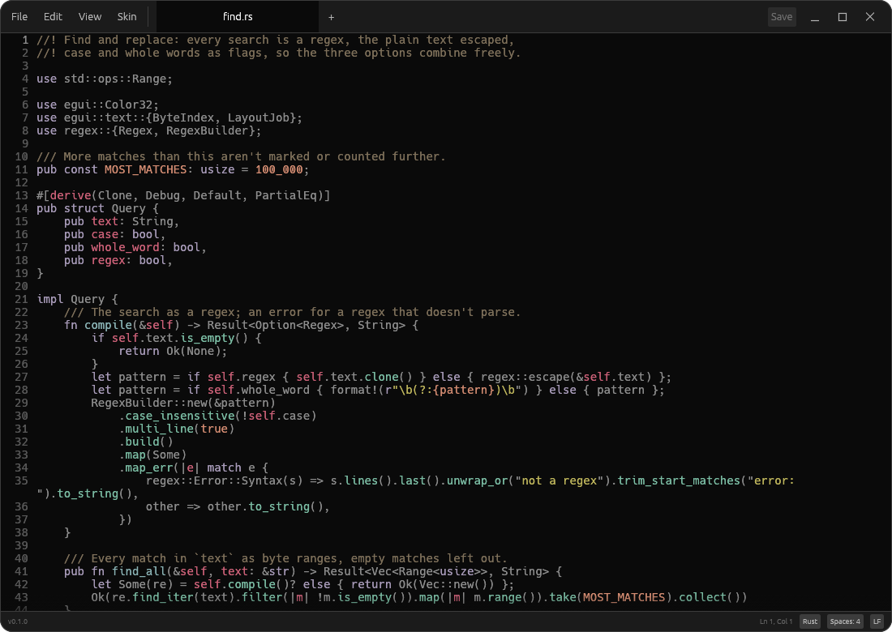
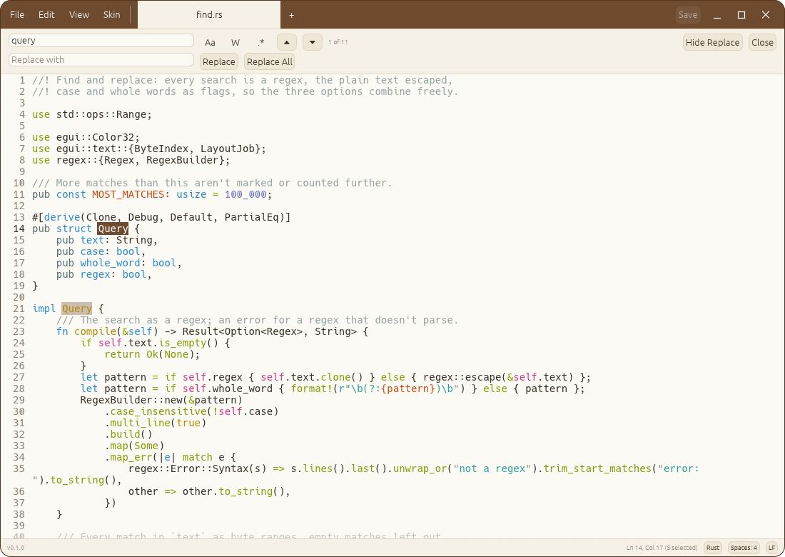

# Text Editor

A text editor for the [Patina](https://github.com/Sector-F-Labs/patina) desktop, doing what GNOME
Text Editor does: documents in tabs, find and replace, syntax highlighting, and unsaved work kept
across restarts, in Patina's frame and skins.

- **Tabs** in the title bar; opening a file that's open shows its tab.
- **Nothing is lost on quitting:** the tabs come back next time, with their unsaved changes, even
  untitled ones never saved. Closing a tab with changes asks first.
- **Find and replace** (Ctrl+F, Ctrl+H) with match case, whole words and regular expressions
  (`$1` in the replacement), every match marked.
- **Highlighting** for bat's 199 languages (TOML, Rust, TypeScript, Dockerfile...), by file name
  or `#!` line, or chosen in the status bar; recoloured a line at a time as you type.
- **Indenting:** Tab and Shift+Tab indent and outdent the selected lines, Enter keeps the line's
  indent; spaces or tabs, guessed from the file.
- **Files as they were:** Windows line ends, a byte-order mark and the file's permissions are kept;
  saves replace the file whole, never half-written. A file changed on disk is read again, unless
  the tab has changes of its own.
- **One window:** `text-editor FILE` while it's open opens FILE there.

## Shortcuts

| Keys | |
|---|---|
| Ctrl+N, Ctrl+T | New tab |
| Ctrl+O | Open |
| Ctrl+S, Ctrl+Shift+S | Save, Save As |
| Ctrl+W | Close tab |
| Ctrl+PageUp/PageDown, Alt+1…9 | Other tabs |
| Ctrl+Z, Ctrl+Shift+Z | Undo, Redo |
| Ctrl+F, Ctrl+H | Find, Find and Replace |
| Ctrl+G, Ctrl+Shift+G (F3, Shift+F3) | Next and previous match |
| Ctrl+I | Go to line (`LINE` or `LINE:COLUMN`) |
| Tab, Shift+Tab | Indent, outdent |
| Ctrl++, Ctrl+-, Ctrl+0 | Bigger, smaller, usual text |
| Escape | Close the find bar |
| Ctrl+Q | Quit |

## Files

- `~/.config/text-editor/config.toml`: skin, view settings, indentation, recent files.
- `~/.config/text-editor/skins/`: your skins.
- `~/.local/share/text-editor/session.toml` and `drafts/`: the open tabs and their unsaved text.

## Build

`make` lists the targets:

- `make run`: this README, in a scratch config and session.
- `make check`: the tests and clippy.
- `make install`: the binary, icon and launcher, for you (`PREFIX=~/.local`).
- `make screenshot`: the images above.

## Licence

BSD 3-Clause; see [LICENSE](LICENSE).
