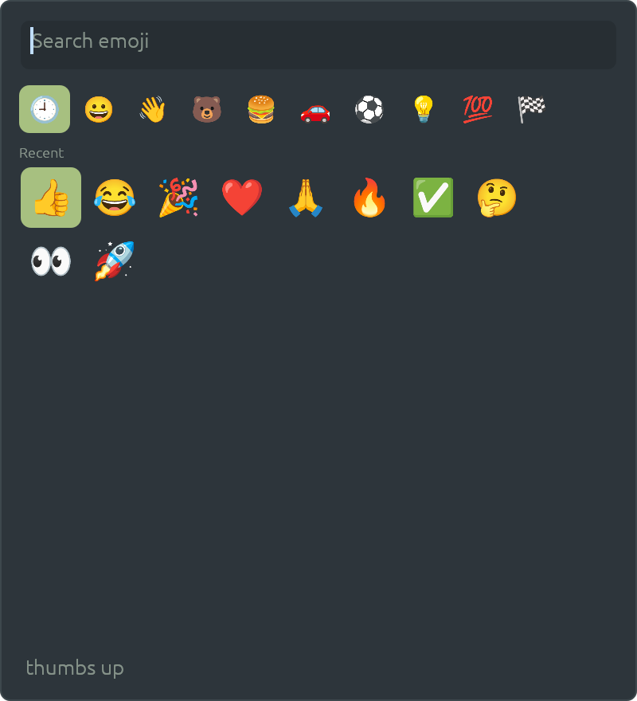

# How the emoji picker fits into the desktop

Press a key, find an emoji, pick it, and it is typed into the window you were in. This page explains how
that works on the Patina desktop, and why the picker is small: it draws a popup, and leaves the typing to
the compositor, which already does it for dictation. The README next to it covers running and building;
the decision is ADR-0120.

| As it opens, once emoji have been picked |
|---|
|  |

## The idea in one paragraph

An ordinary program can't type into another program's window on Wayland: it can't see where the focus is,
and it can't press keys for someone else. The compositor can, because it owns the keyboard, the
clipboard and the focus. Dictation already needed that, so the compositor has one job for it: given a
text on the session bus, type it where the focus is (ADR-0071). The picker is an ordinary program that
shows a grid and, when you choose, makes that one call.

## The sequence, in time


### Why it closes first, and then waits

The picker has the keyboard while it is open (keyboard-interactive: exclusive), so the window you were in
has lost it. If the emoji were sent then, the compositor would paste into the picker. So the picker closes
its surface first, waits 120 ms for the compositor to give the focus back (`FOCUS_BACK` in `main.rs`), and
only then calls `Commit`. The compositor's own wait for modifiers to come up (the key is Ctrl+Super+Space,
and a hand rarely lets go of all three at once) is the same one dictation uses, so the window sees Ctrl+V
and not Ctrl+Super+V.

### Why through the clipboard

The same reasons as dictation's (ADR-0071). The compositor reads the clipboard out of the app that owns it,
serves the emoji as its own selection, presses Ctrl+V (or Ctrl+Shift+V when the window is a terminal, which
it knows), and gives the old clipboard back once the window has read the text. It works in every Wayland
app that pastes. The cost is that a clipboard manager sees the emoji go past.

## What the picker does

- **One at a time.** The picker opens a socket named for itself (`piece::Single`). Run it while it's open
  and the new process sends `close` to the old one and exits, so the key toggles it. Escape closes it, and
  so does clicking another window, since that takes the keyboard away.
- **Where it opens.** A layer-shell overlay with no anchor, which the compositor centres. It's a
  patina-shell piece, as the launcher is, drawn with egui in the desktop's skin, so it follows light and
  dark.
- **Which emoji.** The `emojis` crate has the names, shortcodes and groups. The grid shows the nine groups
  (and Recent first, once there is one) without the skin-tone variants of each, so the default is what's
  typed. Anything the font lacks is left out: the crate is newer than the font.
- **How they're drawn.** egui has no colour glyphs, so each emoji is an image from Patina's `emoji`
  feature: Noto Color Emoji, decoded as a cell scrolls into view. The font itself is the
  `patina-emoji-font` crate, handed to Patina in `main` with `emoji::install`. An emoji with no glyph is
  drawn as text instead.
- **How a search ranks.** Every word of the query has to be in the name or a shortcode. Those whose name
  starts with the first word come first, then those with a word that does, then the rest.
- **Recent emoji.** The last 32, newest first, one a line in `$XDG_DATA_HOME/patina-emoji/recent`.
  Picking one moves it to the top.

## What the compositor does that a client can't

| Job | How it's done here | Why a normal client can't |
|-----|--------------------|---------------------------|
| Hear the key whatever has the focus | `input.rs`: `emoji` in `[keys]` runs `patina-emoji` as a client | clients only get keys when focused |
| Press keys in another window | `KeyboardHandle::input` on the seat, with V looked up in the layout in use | needs a virtual-keyboard protocol, and a keymap of its own |
| Know the window is a terminal | it already tracks it (`cmd.rs`) | a client doesn't know what's focused |
| Paste without losing the clipboard | reads it, serves the emoji, serves the old contents back | a client would overwrite it, and couldn't tell when the paste was done |

The key isn't one of the few the compositor keeps over a fullscreen game (ADR-0102), so in a game it goes
to the game.

## Limits, as they stand

- **Wayland windows only.** With an X11 window focused the emoji is dropped, and a line is logged. X11
  support is deliberately minimal.
- **No skin tones.** Each emoji is typed in its default tone.
- A window that takes more than a second to read the clipboard pastes the old contents, and an app that
  binds Ctrl+V to something else does that instead.
- The popup needs a layer-shell compositor; on others it opens as a window (`window_fallback`).

## The files

```
 emoji/
 ├── src/main.rs        the surface, the single instance, the 120 ms wait and Commit
 ├── src/ui.rs          the search box, categories and grid; the preview test
 ├── src/data.rs        the emoji, searching them, the recent ones
 └── images/            the README's pictures (drawn by the preview test) and the sequence
```

The sequence is hand-drawn SVG that follows the viewer's light or dark theme. The pictures of the picker
are drawn by `PATINA_EMOJI_PREVIEW=dir cargo test -p patina-emoji preview -- --ignored`, in every built-in
skin; the README uses Everforest Dark.
