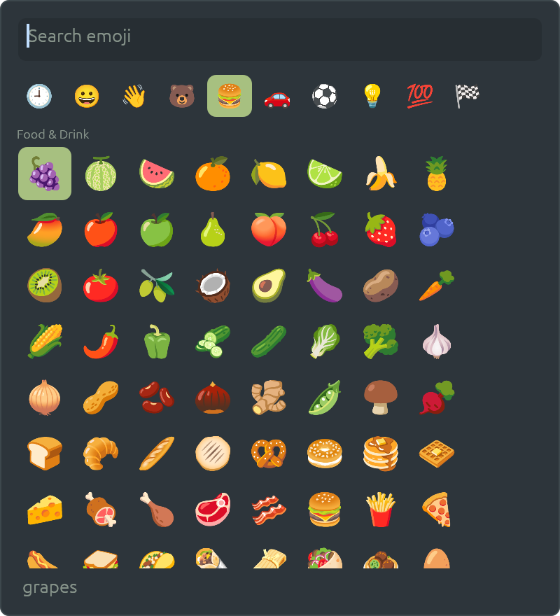
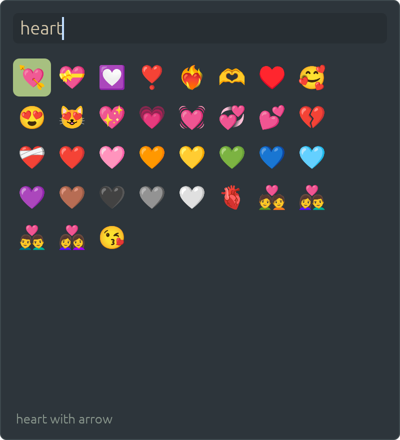

# patina-emoji

| Browsing a category | Searching |
|---|---|
|  |  |

The emoji picker (ADR-0120), as Ctrl+Cmd+Space on a Mac. The compositor opens it on
Ctrl+Super+Space or Super+period (`emoji` in `[keys]`): a popup in the middle of the screen with a
search box, the categories along the top and the emoji in a grid. Enter or a click picks one, and it is
typed into the window that had the focus.

## How it fits in

- **Typing is dictation's** (ADR-0071): the picker closes, waits a moment for the focus to return, and
  calls `Commit(emoji)` on `com.sectorflabs.Patina.Input`; the compositor pastes it through the
  clipboard and gives the clipboard back. Wayland windows only, as dictation.
- **A layer-shell overlay** on patina-shell, like the launcher: keyboard exclusive, closes on
  Escape or when another window is clicked. Running it while open closes it, so the key toggles it.
- **Patina's emoji** (`patina::emoji`, feature `emoji`, Patina's ADR-0031): Noto Color Emoji as
  images, the pack Teleprinter's code first solved, because egui's fonts have no colour emoji. The font
  is the `patina-emoji-font` crate from git, which `main` hands to Patina with `emoji::install`
  (10 MB is too much for Patina's crates.io package). They are decoded as they scroll into view. Emoji newer than the font are left out.

## Seeing it

The pictures above are drawn without a desktop, by an ignored test that paints the picker through
`patina_shell::raster::Painter` into PNGs, one per built-in skin and view (the recent ones, a search and a
category):

```sh
PATINA_EMOJI_PREVIEW=/tmp/p cargo test -p patina-emoji preview -- --ignored
```

`images/recent.png` is the view the picker opens on once something has been picked.

How a pick gets from here into another program's window is in [HOW-IT-WORKS.md](HOW-IT-WORKS.md).

## Code

`main.rs`, the surface and the `Commit`; `ui.rs`, the search box, categories and grid;  `data.rs`,
the emoji (the `emojis` crate), searching them by name and shortcode, and the recent ones kept in
`$XDG_DATA_HOME/patina-emoji/recent`.
