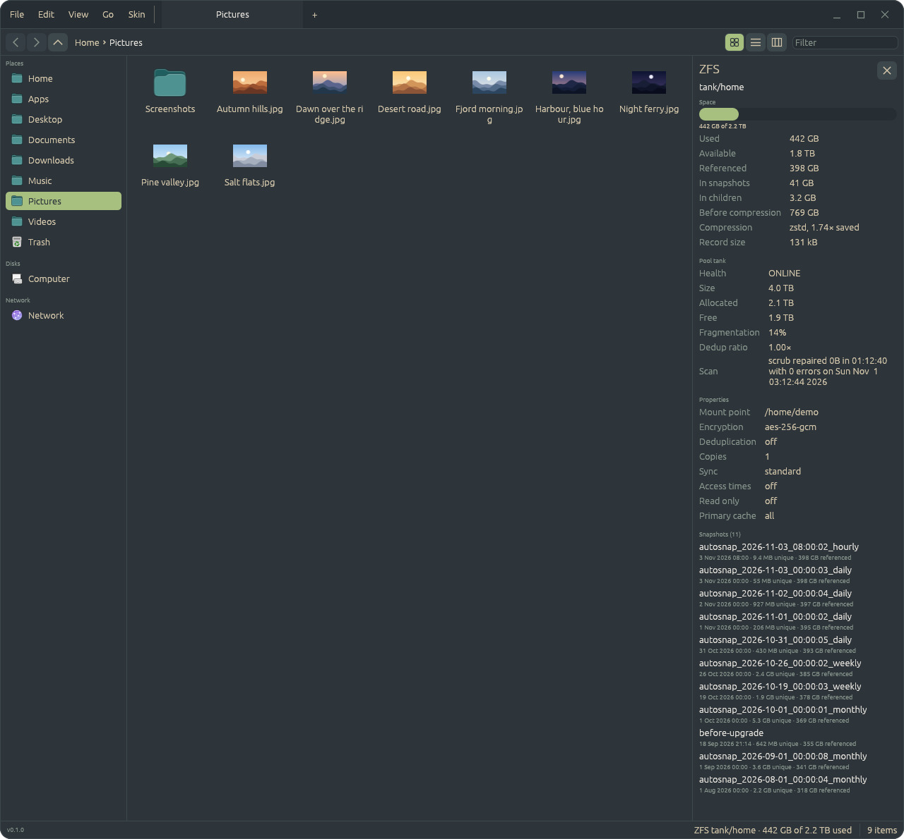
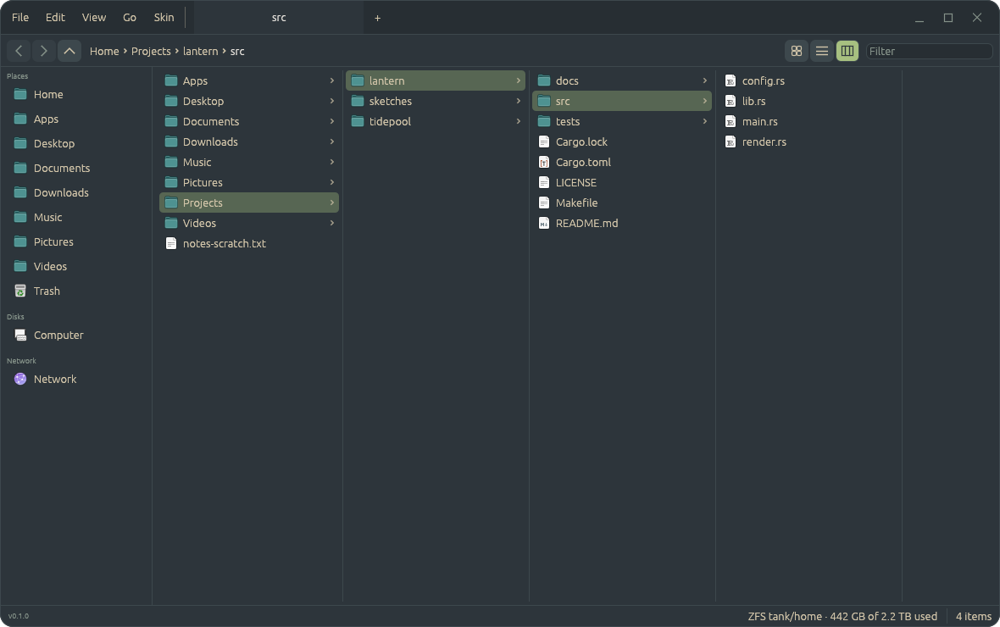
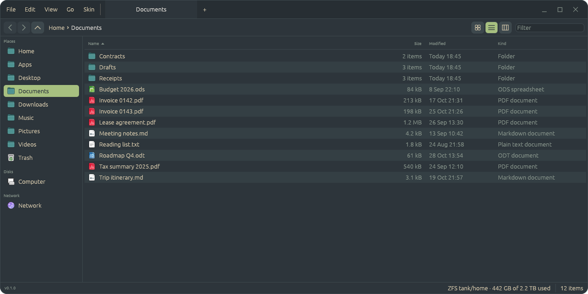

# Files


The file manager of the [Patina desktop](https://github.com/Sector-F-Labs/patina-desktop), and a
[Patina](https://github.com/Sector-F-Labs/patina) app: Patina's window frame and skins, following
the desktop's light/dark setting. It runs on any Linux desktop and on FreeBSD. Folders as icons, a
list or columns, in tabs; copying and moving that never overwrites; network shares; the file
chooser for other apps; and, for a folder on ZFS, a panel with its dataset, pool and snapshots.



## Features

- Folders as icons, a list or columns (Ctrl+1, Ctrl+2, Ctrl+3), in tabs, with a sidebar of places
  and disks. The list's columns after Name (Size, Date Modified, Date Created, Date Last Opened,
  Kind) are chosen from the header's menu. Columns open a folder to the right of the last, as a
  Mac's Finder does.
- **ZFS**: when the folder shown is on a ZFS dataset, the status bar says which one and how full it
  is. Click it and a panel opens on the right with the dataset's space (what snapshots hold, what
  compression saved), its pool (health, fragmentation, the last scrub), a few properties
  (encryption, sync, …) and its snapshots, newest first, with when each was taken and what it holds
  alone. It reads `zfs` and `zpool` on a thread, only while it's open, and says nothing on other
  folders.
- Thumbnails for pictures; icons from the desktop's icon theme by file type.
- Quick Look: Space shows the selected picture large in a window of its own (anything else as
  its icon and details); the arrow keys step through the folder, Space or Escape closes it.
- Copy, cut and paste (on the clipboard in Nautilus's form, so the two paste each other's), drag
  to move (Ctrl to copy; another disk copies), rename in place (F2), new folder (Ctrl+Shift+N).
- Nothing is overwritten: an operation takes a free name, or asks what to do about a taken one
  (merge, replace, keep both, skip), and what a replace replaces goes to the Trash.
- Drag files between Files windows, out into other apps (Telegram, a browser, Nautilus) and in
  from them, on Wayland.
- The Trash (freedesktop spec): Delete moves there; put back, delete permanently, empty.
- Click, Ctrl/Shift-click, a band on the background, arrows and typing a name to select.
- Path bar to click or drop on, Ctrl+L to type a location, Filter for the folder.
- Watches the folders on screen and re-reads them when they change.
- The network, through GVfs as in Nautilus: servers found on the network, a server's shares,
  mounting one (with a password, saved in the keyring if you like) and unmounting from the
  sidebar; `smb://` URIs in the location bar or Go → Connect to Server….
- The file chooser for other apps: in the Patina session, any app that asks the desktop portal
  for a file (rfd's default, Firefox, Chrome, GTK and Qt apps set to use portals) gets Files'
  chooser: open, several files, a folder, or save, with the app's file types.
- App folders: a `Name.app` folder is an app, as on a Mac, shown as one item with its own icon and
  run when it's opened (right-click → Show Contents to look inside). Apps are folders with an
  `app.toml` (Patina OS ADR-0004); the rules come from the shared
  [patina-apps](https://github.com/Sector-F-Labs/patina-apps) crate, which the Patina desktop's
  launcher uses too, so `.app` folders work wherever Files is installed.
- Patina skins (Skin menu, as in every Patina app; `~/.config/files/skins`), a status bar, and
  the Patina frame or the desktop's.





## Shortcuts

| Keys | Does |
|------|------|
| Ctrl+1 / Ctrl+2 / Ctrl+3 | Icons / list / columns |
| Space | Quick Look at the selected file; Space or Escape closes it |
| F2 | Rename in place |
| Ctrl+Shift+N | New folder |
| Ctrl+N | New window |
| Ctrl+L | Type a location |
| Ctrl+F | Focus the filter |
| Ctrl+H | Show or hide hidden files |
| Ctrl+A | Select all |
| Ctrl+I, Alt+Enter | Properties |
| Enter | Open the selected item |
| Backspace, Alt+Up | Up a folder |
| Alt+Left / Alt+Right | Back / forward |
| Alt+Home | Home |
| Delete | Move to the Trash |
| Ctrl+W | Close the tab (the window, on the last) |
| Ctrl+Q | Quit |

The ZFS panel has no key: click the dataset in the status bar, or its ✕.

## Install

```sh
make install      # ~/.local/bin/files, its .desktop file and icon
make default      # optional: open folders in Files instead of Nautilus
make install-portal   # be the file chooser in the Patina session (root; SUDO=doas)
make app          # or target/Files.app, to copy into ~/Apps
```

It depends on [patina-apps](https://github.com/Sector-F-Labs/patina-apps) and Patina from GitHub.
On the Patina desktop it is installed with the rest of the desktop (`make install-full`).

## Develop

```sh
make              # list the targets
make run          # run it
make check        # tests and clippy
make icon         # re-render docs/icon.png from packaging/linux/files.svg
make screenshots  # re-make docs/screenshots on made-up data (docs/demo)
FILES_SCREENSHOT=shot.png cargo run -- ~/somewhere   # saves the window and quits
```

The screenshots show invented files, and fake `zfs` and `zpool` answers for the ZFS panel, so
nothing of a real machine is in them; [docs/demo](docs/demo/README.md) says how.

Decisions are in [docs/adr](docs/adr/README.md).

## Licence

BSD-3-Clause.
