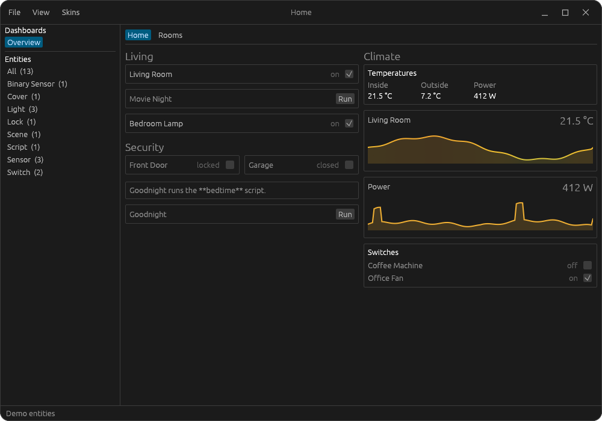

# Home

A private [Patina](https://github.com/Sector-F-Labs/patina) app: a native interface for Home
Assistant. Lists your entities by domain, toggles lights, switches, locks and covers, and runs
scenes and scripts.

## Setup

Run it, choose **File → Account…** and enter your Home Assistant address and a long-lived access
token (Home Assistant profile → Security). They're kept in `~/.config/home/account.toml`, readable
only by you.

## Shortcuts

| Key | Action |
|-----|--------|
| F5 | Refresh |
| Ctrl+Q | Quit |

## Build

Run `make` to list the targets: `make run`, `make check`, `make install` and so on.

Private; not for distribution. Licence: BSD-3-Clause.
