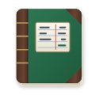
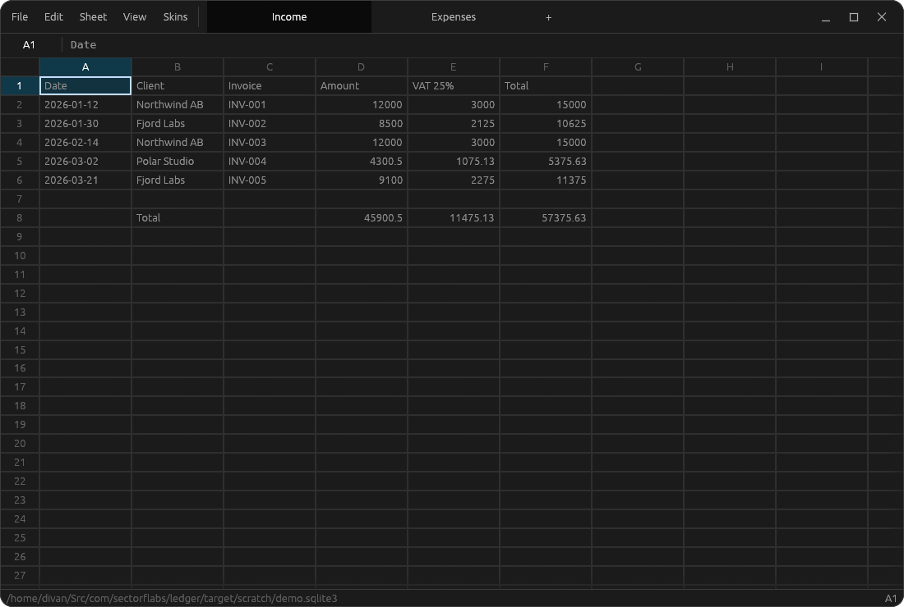

# Ledger



Ledger is a desktop app for bookkeeping in tabbed spreadsheets. A ledger is one SQLite database
file: every sheet is a tab, and the file can be read with any SQLite tool. It's built with
[egui](https://github.com/emilk/egui) on [Patina](https://github.com/Sector-F-Labs/patina), so it
shares a window frame and skins with Notebook, Calendar and Photograph.



## Features

- **Tabbed sheets:** the tabs sit in the title bar. `+` or Ctrl+T adds a sheet, a tab's right-click
  menu renames it, and tabs can be dragged into another order.
- **A real grid:** click or use the arrows to move, Shift to select a block, Ctrl+arrows to jump
  to the edge of the data. Type to replace a cell, double-click or F2 to edit what's in it, Enter
  and Tab to commit and move on, Esc to cancel. Cut, copy and paste work as tab-separated text, so
  they work with other spreadsheets.
- **Formulas:** `=D2+E2`, `=SUM(D2:D9)`, `=ROUND(D2*0.25, 2)`. Operators `+ - * / ^ &`, and
  `SUM`, `AVERAGE`, `MIN`, `MAX`, `COUNT`, `ABS`, `ROUND`. Errors show in the cell (`#DIV/0`,
  `#CYCLE`, ...) and nothing else stops. References stay within one sheet.
- **A status bar** with the selected range, and its sum, average and count.
- **No Save:** every edit is written to the file as you make it, off the UI thread.
- **Skins:** Patina's skins, and any in `~/.config/ledger/skins/`, are in the Skins menu.


## The file

A ledger is a plain SQLite file (`.sqlite3` by default) with two tables:

```sql
sheets (id, name, position)
cells  (sheet_id, row, col, input)   -- input is exactly what was typed; "=..." is a formula
```

`PRAGMA application_id` is `0x4C444752` ("LDGR") so Ledger can tell its files from other
databases, and `user_version` is the format version. See `docs/adr/` for why.

```bash
sqlite3 books.sqlite3 "select s.name, c.row+1, c.col, c.input from cells c join sheets s on s.id = c.sheet_id"
```

Ledger opens the file you give it, or the last one you used:

```bash
ledger books.sqlite3
```

## Shortcuts

| Keys | Does |
|---|---|
| Ctrl+N / Ctrl+O | New ledger / open one |
| Ctrl+T / Ctrl+W | New sheet / delete the shown one |
| Ctrl+PgUp / Ctrl+PgDn, Alt+1…9 | Another sheet |
| Arrows, Tab, Enter | Move (Shift for the opposite direction or to select) |
| Ctrl+arrows, Ctrl+Home | Jump to the edge of the data / to A1 |
| F2 | Edit the cell |
| Delete | Clear the selection |
| Ctrl+X / C / V, Ctrl+A | Cut, copy, paste, select the data |
| Ctrl+Q | Quit |

## Build

```bash
make            # list the targets
make run        # run it
make dev        # run it on demo books, in a scratch config
make check      # tests and clippy -D warnings
make screenshot # regenerate docs/screenshot-*.png
make install    # per-user install, with the launcher and icon (PREFIX=~/.local)
```

Ledger depends on Patina's `develop` branch on git, as every Sector F app does.

## Licence

BSD 3-Clause. See [LICENSE](LICENSE).
