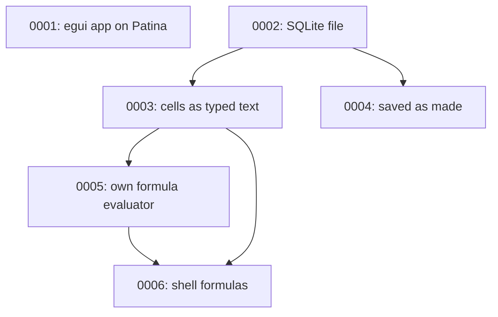

# Architecture Decision Records

This directory holds ADRs for Ledger — short records of significant architecture decisions,
written at the time they're made, following Michael Nygard's format as popularized by Martin
Fowler: <https://martinfowler.com/bliki/ArchitectureDecisionRecord.html>.

## When to write one

Write an ADR when a decision is:

- Hard, or expensive, to reverse once other code depends on it.
- Not obvious from reading the code — a "why", not a "what".
- The kind of thing that'll get re-litigated later without a record ("didn't we already decide
  this?").

Small, reversible choices don't need one. Rule of thumb: if you'd want to explain the choice to a
new contributor in a paragraph beyond what the code itself shows, it's ADR-sized.

An ADR is a point-in-time record of *a decision as it was made*, including the options considered
and rejected. It does not get rewritten later — a decision that reverses or replaces an earlier one
gets its own new ADR that supersedes the old one, which stays in place with its status updated.

## Convention

- One file per decision: `NNNN-short-kebab-title.md`, numbered sequentially, zero-padded to 4
  digits. Numbers are never reused, even for a decision that gets reversed.
- Start from [`0000-template.md`](0000-template.md) — copy it, don't write from scratch.
- `Status` is one of: `Proposed`, `Accepted`, `Rejected`, `Deprecated`, or `Superseded by
  ADR-NNNN` (linked to the superseding record).
- Every new ADR gets a row in the index below.
- Keep records short — a paragraph or two per section is normal. An ADR documents a decision and
  its reasoning, not a design document.

Ledger is a [Patina](https://github.com/Sector-F-Labs/patina) app. Decisions about the shared
frame, skins and components are recorded in Patina's own ADRs; record here only what this app
decides.

If you're working with Claude Code in this repo, `.claude/skills/adr/SKILL.md` automates the
mechanics of adding one.

## Index

| # | Title | Status |
|---|-------|--------|
| [0001](0001-build-on-patina.md) | Build Ledger as a native egui app on Patina | Accepted |
| [0002](0002-a-ledger-is-a-sqlite-database.md) | A ledger file is a SQLite database | Accepted |
| [0003](0003-cells-are-stored-as-typed-text.md) | Cells are stored as the text that was typed | Proposed |
| [0004](0004-edits-are-saved-as-made.md) | Edits are saved as they're made, off the UI thread | Proposed |
| [0005](0005-own-formula-evaluator.md) | A small formula evaluator of our own, within one sheet | Proposed |
| [0006](0006-shell-formulas-fill-blocks.md) | Shell formulas fill a block of cells, and only run in trusted ledgers | Proposed |

## Decision Relationship

## Revisit Triggers

- Other tools need formula results from the file: add a stored `value` column ([0003](0003-cells-are-stored-as-typed-text.md)).
- Money sums drift in `f64`: move to a decimal type ([0005](0005-own-formula-evaluator.md)).
- A sheet reaches hundreds of thousands of cells: load lazily instead of in full ([0004](0004-edits-are-saved-as-made.md)).
- A command needs to read a range, or results go stale unnoticed: dependency-aware re-runs ([0006](0006-shell-formulas-fill-blocks.md)).
- Trust per file is too coarse, or a sandbox becomes available: per-command trust ([0006](0006-shell-formulas-fill-blocks.md)).
- Two people or apps need the same file at once: add locking and change detection ([0002](0002-a-ledger-is-a-sqlite-database.md)).
