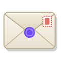
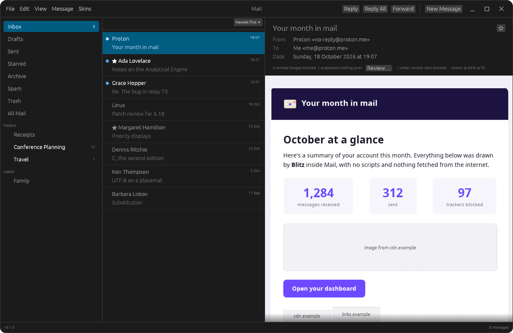
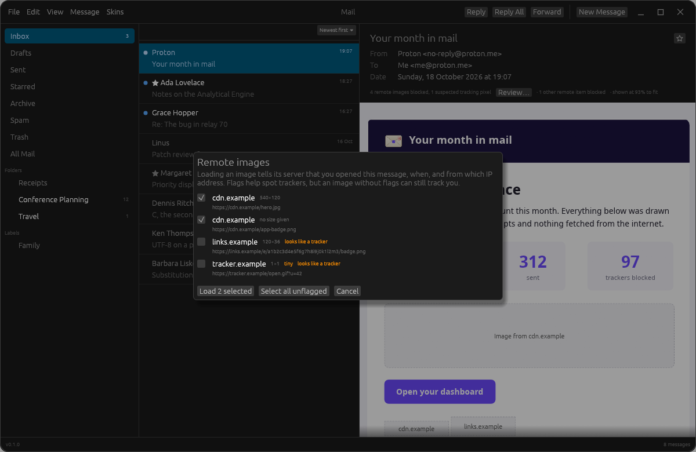

# Mail

A simple mail client for [Proton Mail](https://proton.me/mail), through
[Proton Mail Bridge](https://proton.me/mail/bridge) running on the same machine. It's a
[Patina](https://github.com/Sector-F-Labs/patina) app: a native egui window that takes the same
skins as Calendar, Notebook and the rest of the family.





- Your Proton folders and labels, with unread counts.
- A folder's newest 200 messages; open one to read it.
- Sort the list by date, sender or subject, either way round, with unread or starred mail at
  the top if you like: from the strip over the list, or View → Sort By. Sorting by subject ignores
  "Re:" and "Fwd:".
- HTML mail drawn as its sender meant, by [Blitz](https://github.com/DioxusLabs/blitz), but safely:
  no scripts ever run, and nothing is fetched from the internet unless you choose. Remote images
  show as boxes naming their server: click one to load it, or use Review… to see every image with
  its size and tracker flags and pick which to load. Images that declare themselves tiny or hidden
  become a "Suspected tracking pixel" box linking to
  [EFF's explanation](https://www.eff.org/deeplinks/2019/01/stop-tracking-my-emails). Remote
  styles and fonts never load; wide newsletters are scaled to fit; clicking a link
  asks first, and warns when its text names a different site from where it goes. View → Show HTML
  mail as text switches it off.
- Write, reply, reply all and forward; save attachments to Downloads.
- Star, mark unread, archive and move to Trash.

## Setting up

1. Run Proton Mail Bridge and sign in.
2. In Bridge, open your account's mailbox details for the username (your address) and Bridge's
   own password (not your Proton password).
3. In Mail, File → Account…, enter them. The server and ports default to Bridge's
   (127.0.0.1, IMAP 1143, SMTP 1025, STARTTLS). If you switched Bridge to SSL, choose SSL.

The login is kept in `~/.config/mail/account.toml`, readable only by you. Bridge's certificate is
self-signed, so it's accepted unchecked only when the server is this machine.

## Shortcuts

| Keys | Does |
|------|------|
| Ctrl+N | New message |
| Ctrl+R | Reply |
| Ctrl+Shift+R | Reply all |
| Ctrl+L | Forward |
| Ctrl+Enter | Send (in the compose window) |
| ↓ / J, ↑ / K | Next, previous message |
| S | Star or unstar |
| Ctrl+U | Mark as unread |
| A | Archive |
| Delete | Move to Trash |
| F5 | Check for mail |
| Ctrl+Q | Quit |

## Build

`make` lists the targets:

```
make run          # run with your own settings
make demo         # made-up mail, no connection, scratch config
make check        # tests and clippy
make screenshot   # docs/screenshot-*.png from the demo mail
make install      # per-user install with a launcher (PREFIX=~/.local)
```

## Licence

BSD 3-Clause; see [LICENSE](LICENSE).
