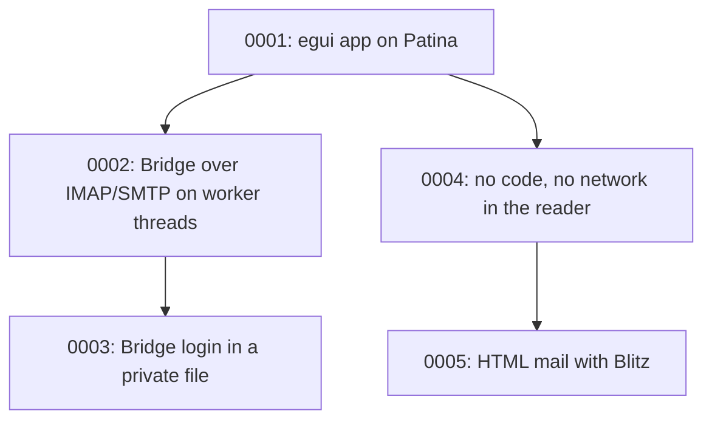

# Architecture Decision Records

This directory holds ADRs for Mail — short records of significant architecture decisions,
written at the time they're made, following Michael Nygard's format as popularized by Martin
Fowler: <https://martinfowler.com/bliki/ArchitectureDecisionRecord.html>.

## When to write one

Write an ADR when a decision is:

- Hard, or expensive, to reverse once other code depends on it.
- Not obvious from reading the code — a "why", not a "what".
- The kind of thing that'll get re-litigated later without a record ("didn't we already decide
  this?").

Small, reversible choices don't need one. Rule of thumb: if you'd want to explain the choice to a
new contributor in a paragraph beyond what the code itself shows, it's ADR-sized.

An ADR is a point-in-time record of *a decision as it was made*, including the options considered
and rejected. It does not get rewritten later — a decision that reverses or replaces an earlier one
gets its own new ADR that supersedes the old one, which stays in place with its status updated.

## Convention

- One file per decision: `NNNN-short-kebab-title.md`, numbered sequentially, zero-padded to 4
  digits. Numbers are never reused, even for a decision that gets reversed.
- Start from [`0000-template.md`](0000-template.md) — copy it, don't write from scratch.
- `Status` is one of: `Proposed`, `Accepted`, `Rejected`, `Deprecated`, or `Superseded by
  ADR-NNNN` (linked to the superseding record).
- Every new ADR gets a row in the index below.
- Keep records short — a paragraph or two per section is normal. An ADR documents a decision and
  its reasoning, not a design document.

Mail is a [Patina](https://github.com/Sector-F-Labs/patina) app. Decisions about the shared
frame, skins and components are recorded in Patina's own ADRs; record here only what this app
decides.

If you're working with Claude Code in this repo, `.claude/skills/adr/SKILL.md` automates the
mechanics of adding one.

## Index

| # | Title | Status |
|---|-------|--------|
| [0001](0001-build-on-patina.md) | Build Mail as a native egui app on Patina | Accepted |
| [0002](0002-bridge-over-imap-and-smtp.md) | Talk to Proton Mail Bridge over IMAP and SMTP, on worker threads | Proposed |
| [0003](0003-account-in-a-private-file.md) | Keep the Bridge login in a private file | Proposed |
| [0004](0004-no-code-no-network-reader.md) | Mail never runs code or fetches anything it wasn't asked to | Accepted |
| [0005](0005-render-html-mail-with-blitz.md) | Render HTML mail with Blitz | Proposed |

## Decision Relationship

## Revisit Triggers

- Blitz stalls, or its beta breaks too often: reconsider the renderer ([0005](0005-render-html-mail-with-blitz.md)).
- A renderer can't meet these rules and plain text proves too poor: weigh fidelity against [0004](0004-no-code-no-network-reader.md) in a new ADR.
- Mail needs to work offline, or folders feel slow to open: add a disk cache ([0002](0002-bridge-over-imap-and-smtp.md)).
- New mail arriving late becomes a nuisance: IMAP IDLE ([0002](0002-bridge-over-imap-and-smtp.md)).
- `imap` 3.0 ships stable, or its alpha breaks: re-pin ([0002](0002-bridge-over-imap-and-smtp.md)).
- Mail connects to anything other than a local Bridge: move the password to the keyring ([0003](0003-account-in-a-private-file.md)).
