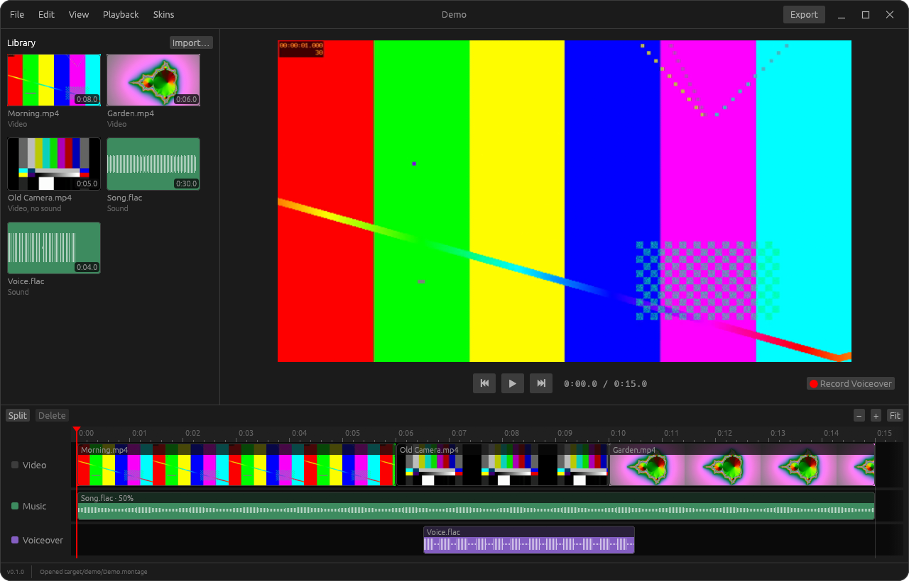

# Montage


Montage is a video editor for home movies, in the spirit of iMovie and Windows Movie Maker
rather than Premiere or DaVinci Resolve. Put your clips in a library, drag them onto a timeline,
lay music and a voiceover under them, and export an MP4. It's built with
[egui](https://github.com/emilk/egui) on [Patina](https://github.com/Sector-F-Labs/patina), for
the Patina desktop, so it shares a window frame and skins with the other Patina apps.



## Features

- **A library** of videos and sound files, with thumbnails, waveforms and lengths. Import with
  File → Import Media, or drop files on the window.
- **A timeline** with three tracks:
  - **Video:** clips play one after another. Drop a clip between two others to put it there,
    and drag one along to move it.
  - **Music** and **Voiceover:** sound placed wherever you drop it, snapping to the cuts and the
    playhead, with its waveform drawn.
  - Trim any clip by dragging its edges. Split it at the playhead, delete it, or set its volume
    (mute, quieter, normal, louder) from its right-click menu.
- **Record a voiceover:** press Record Voiceover and talk while the movie plays silently. The
  recording lands on the Voiceover track where you started.
- **Preview** with sound, from wherever the playhead is.
- **Export** to an MP4 (H.264 and AAC) at 480p, 720p or 1080p, in the background, with progress
  in the status bar.
- **Undo** and redo for every edit, and projects saved as `.montage` files.

## Shortcuts

| Keys                   | Action                                |
| ---------------------- | ------------------------------------- |
| Space                  | Play or pause (stops a recording)     |
| ← / →                  | Previous / next frame                 |
| Shift+← / Shift+→      | Back / forward a second               |
| Home / End             | Go to the start / end                 |
| Ctrl+B                 | Split at the playhead                 |
| Delete                 | Delete the selected clip              |
| Ctrl+Z / Ctrl+Shift+Z  | Undo / redo                           |
| Ctrl+R                 | Record a voiceover, or stop recording |
| Ctrl++ / Ctrl+- / Ctrl+0 | Zoom in / out / to fit (also Ctrl and the wheel) |
| Ctrl+I                 | Import media                          |
| Ctrl+E                 | Export the movie                      |
| Ctrl+N / Ctrl+O / Ctrl+S / Ctrl+Shift+S | New, open, save, save as |
| Ctrl+Q                 | Quit                                  |

## Requirements

Montage runs `ffmpeg` and `ffprobe` to read, play, record and export
([ADR-0002](docs/adr/0002-media-through-the-ffmpeg-command-line.md)), so install ffmpeg from your
packages (`apt install ffmpeg`, `pkg install ffmpeg`). Voiceovers are recorded from the default
microphone through PulseAudio/PipeWire on Linux and OSS on FreeBSD.

## Build

```sh
make            # list the targets
make run        # run with your own settings
make demo       # generate demo clips and open them, in a scratch config
make check      # tests (some run ffmpeg) and clippy
make install    # install for you, under ~/.local
make app        # target/Montage.app, a folder app for the Patina desktop's ~/Apps
```

Decisions are recorded in [docs/adr](docs/adr/README.md).

## Licence

BSD 3-Clause; see [LICENSE](LICENSE).
