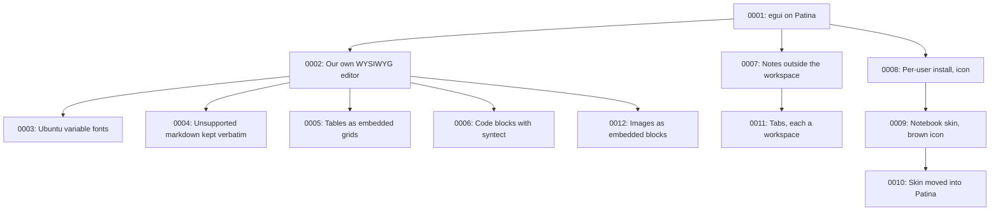

# Architecture Decision Records

This directory holds ADRs for Notebook — short records of significant architecture decisions,
written at the time they're made, following Michael Nygard's format as popularized by Martin
Fowler: <https://martinfowler.com/bliki/ArchitectureDecisionRecord.html>.

## When to write one

Write an ADR when a decision is:

- Hard, or expensive, to reverse once other code depends on it.
- Not obvious from reading the code — a "why", not a "what".
- The kind of thing that'll get re-litigated later without a record ("didn't we already decide
  this?").

Small, reversible choices don't need one. Rule of thumb: if you'd want to explain the choice to a
new contributor in a paragraph beyond what the code itself shows, it's ADR-sized.

An ADR is a point-in-time record of *a decision as it was made*, including the options considered
and rejected. It does not get rewritten later — a decision that reverses or replaces an earlier one
gets its own new ADR that supersedes the old one, which stays in place with its status updated.

## Convention

- One file per decision: `NNNN-short-kebab-title.md`, numbered sequentially, zero-padded to 4
  digits. Numbers are never reused, even for a decision that gets reversed.
- Start from [`0000-template.md`](0000-template.md) — copy it, don't write from scratch.
- `Status` is one of: `Proposed`, `Accepted`, `Rejected`, `Deprecated`, or `Superseded by
  ADR-NNNN` (linked to the superseding record).
- Every new ADR gets a row in the index below.
- Keep records short — a paragraph or two per section is normal. An ADR documents a decision and
  its reasoning, not a design document.

If you're working with Claude Code in this repo, `.claude/skills/adr/SKILL.md` automates the
mechanics of adding one.

Decisions made for the GTK version live in that repo (`com/divanv/notebook-old-gtk`); the ones that still
hold are restated here, marked as carried over.

## Index

| # | Title | Status |
|---|-------|--------|
| [0001](0001-rewrite-in-egui-on-patina.md) | Rewrite Notebook as an egui app on Patina, in a new repo | Accepted |
| [0002](0002-own-wysiwyg-editor.md) | Edit notes in a WYSIWYG rich-text widget of our own | Accepted |
| [0003](0003-note-text-in-ubuntu-variable-fonts.md) | Set note text in the bundled Ubuntu variable fonts | Proposed |
| [0004](0004-keep-unsupported-markdown-verbatim.md) | Keep markdown the editor can't represent as verbatim raw text | Accepted (carried over) |
| [0005](0005-tables-with-markdown-cells.md) | Embed tables as grids of cells holding inline markdown | Accepted (carried over) |
| [0006](0006-code-blocks-highlighted-with-syntect.md) | Embed code blocks with a language picker, highlighted by syntect through egui_extras | Proposed |
| [0007](0007-notes-outside-the-workspace-open-on-their-own.md) | Open notes from outside the workspace on their own | Accepted (carried over) |
| [0008](0008-install-per-user-replacing-the-gtk-binary.md) | Install per user with make install, replacing the GTK Notebook's binary | Proposed |
| [0009](0009-built-in-notebook-skin.md) | Ship a built-in Notebook skin, brown bar on cream paper, and start in it | Accepted (starting skin Proposed) |
| [0010](0010-skin-moves-into-patina.md) | Move the Notebook skin and bar_controls into Patina | Accepted |
| [0011](0011-tabs-each-a-workspace.md) | Tabs, each a workspace of its own, in Patina's tab strip | Proposed |
| [0012](0012-images-as-embedded-blocks.md) | Show images on their own line as embedded blocks, copying in ones from outside | Proposed |
| [0013](0013-the-markdown-widget-moves-to-patina.md) | The markdown model and the WYSIWYG widget move to Patina | Accepted |

## Decision Relationship

## Revisit Triggers

- IME composition misbehaves, very long notes get slow, or accessibility is needed. See
  [ADR-0002](0002-own-wysiwyg-editor.md).
- egui's variable-font support changes. See [ADR-0003](0003-note-text-in-ubuntu-variable-fonts.md).
- Opening notes from the file manager spawns too many windows. See
  [ADR-0007](0007-notes-outside-the-workspace-open-on-their-own.md).
