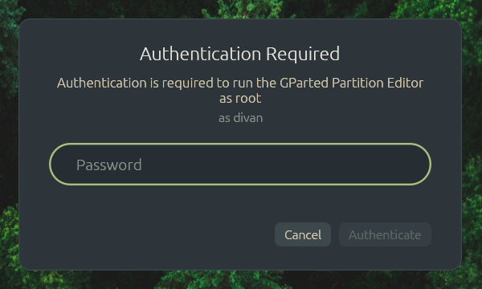

# patina-polkit



The session's polkit agent (ADR-0128): the password dialog for anything that needs administrator
rights, such as `pkexec`, GParted, Disks and Software.

## On the desktop

When an app asks polkit for rights you don't have yet, a dialog opens in the middle of the screen
saying what is being asked and who is authenticating, with a box for the password. Enter
authenticates, Escape or Cancel refuses. A wrong password asks again.

## How it fits in

- **Started by** the compositor, kept running like the bar, on the hardware only. Nested, the parent
  desktop has the agent: polkit allows one per login session, and a second one exits with an error.
- **Registers** on the system bus with polkit's Authority for this login session
  (`XDG_SESSION_ID`, else logind), and again if polkitd restarts.
- **Asks** by running itself as `patina-polkit --ask`, a patina-shell overlay (as the lock
  screen), one for each request, and closes it when polkit cancels the request.
- **Checks the password** with polkit's agent helper, which does the PAM conversation as root and
  tells polkit when it succeeds: a socket-activated service at `/run/polkit/agent-helper.socket` on
  current polkit, else the setuid `polkit-agent-helper-1`. This program only carries the prompts and
  answers between it and the dialog; the password is never kept or logged.

How the pieces fit, with diagrams: [HOW-IT-WORKS.md](HOW-IT-WORKS.md).

## Code

`main.rs` (the two modes), `agent.rs` (the bus, the helper and the dialog's child process),
`dialog.rs` (the overlay and its line protocol with the agent).

## Seeing it

`PATINA_POLKIT_PREVIEW=/tmp/p cargo test -p patina-polkit preview -- --ignored` paints the dialog
in every built-in skin (empty, typed into, refused, checking) as PNGs in that folder, with no
desktop needed. On a Patina session, `pkexec true` (or a launcher for GParted) opens the real one.

## Running

On a desktop with no agent (a Patina session, from inside it):

```sh
patina-polkit &
pkexec id
```
