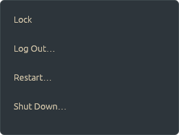
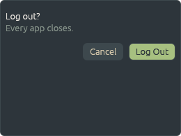

# patina-power

|  |  |
|---|---|

The power menu at the bar's right end (ADR-0048): Lock, Log Out, Restart and Shut Down.

## On the desktop

From the power button after the bar's clock: four rows. Lock locks at once; Log Out…, Restart…
and Shut Down… ask first, in the menu, since every app closes. What can't be done here is greyed
out, with why on hover; a refusal is shown in the menu. Escape takes a question back, then closes
the menu, as does a click elsewhere or the button again.

## How it fits in

- **Started by** the bar's power button (its `power` command), with the bar's skin and edge,
  through the compositor's `Spawn`. A second run closes the open one (patina-shell's `Single`).
- **Locks and logs out** through the compositor's `com.sectorflabs.Patina.Session` on the session
  bus (patina-system's `session.rs`): the `[lock] command`, and the compositor quitting cleanly,
  which ends patina-session. Where the compositor can't be asked, Lock runs `patina-lock` itself.
- **Restarts and shuts down** through logind on the system bus, or ConsoleKit2 where there's no
  logind (FreeBSD), off the UI thread.

`PATINA_POWER_PREVIEW=/tmp/p cargo test -p patina-power preview -- --ignored` draws both in every
built-in skin, without a desktop.

## Code

`main.rs` (one copy, the worker carrying out actions, the surface), `ui.rs` (the rows and the
question).

## Running

```sh
cargo run -p patina-power
```

It opens at the bar's button that opened it, from `PATINA_OPEN_AT` (patina-shell's
`piece::opening`, ADR-0063), or on the bar's edge without it.
