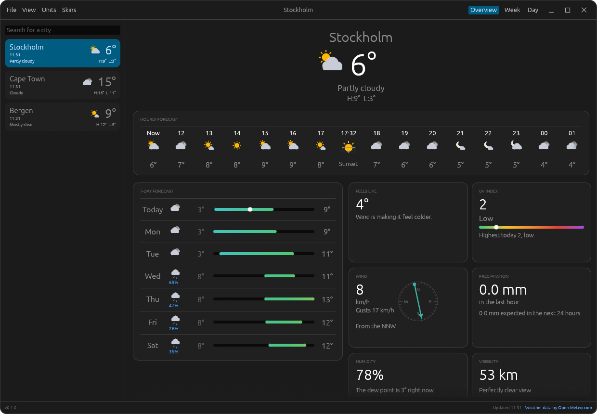
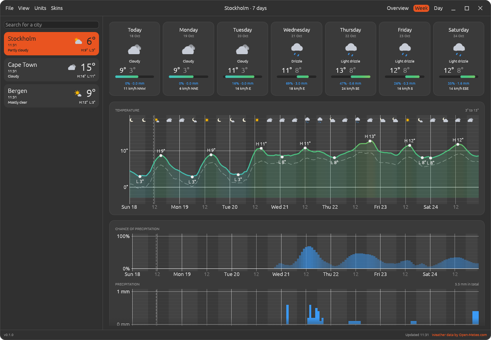
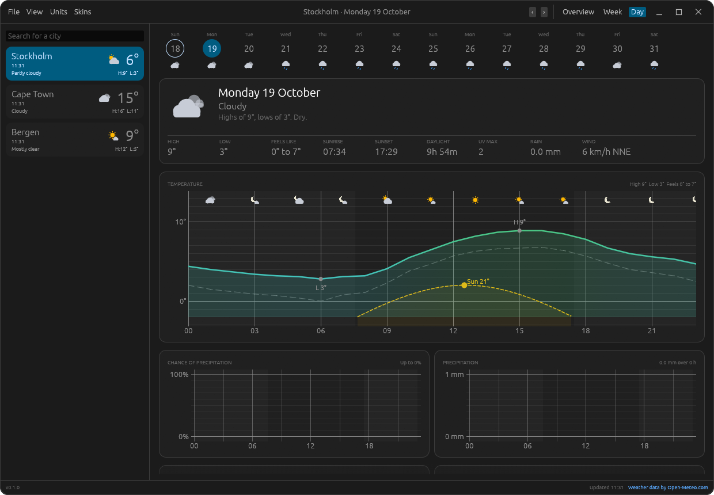

# Weather


A weather app for the Linux desktop, after macOS Weather: the weather now, the next hours and the
days ahead, each day in detail, and graphs of it all. Built on egui and
[Patina](https://github.com/Sector-F-Labs/patina), with forecasts from
[Open-Meteo](https://open-meteo.com/) (no account or key needed).



- **Overview:** the weather now, the next 24 hours with sunrise and sunset, the next 7, 10 or 14
  days with temperature range bars, and tiles for feels-like, UV, wind, precipitation, humidity,
  visibility, pressure, the sun and air quality.
- **Week:** the days side by side, and graphs across them of temperature, the chance and amount
  of precipitation, and wind.
- **Day:** any day of the next 14 in detail, with graphs of temperature and feels-like against
  the sun's height from sunrise to sunset,
  precipitation, wind and its direction, UV, humidity, cloud cover, pressure and visibility.
  Hovering any graph shows that hour across all of them.
- Any number of places, found by searching in the sidebar.
- °C or °F, km/h, m/s, mph or knots, and metric or imperial rain, distance and pressure.
- Patina's skins, including the shared ones, with the weather's own colours under
  `[app.weather]`.





## Shortcuts

| Keys | Does |
|------|------|
| Ctrl+1, Ctrl+2, Ctrl+3 (or O, W, D) | Overview, Week, Day |
| ← → | Previous or next day |
| ↑ ↓ | Previous or next place |
| Ctrl+F or Ctrl+L | Search for a place to add |
| Enter in the search | Add the first result |
| Ctrl+R | Refresh |
| Ctrl+Q | Quit |

Right-click a place in the sidebar to move or remove it. Click a day anywhere to open it.

## Skinning

A skin's `[app.weather]` section can set any of these; what it leaves out keeps the default.

```toml
[app.weather]
sun = "#FFB800"
moon = "#E8E4D0"
cloud = "#C7CCD6"
rain = "#3B9AF5"
snow = "#EAF2FF"
lightning = "#FFD60A"
temperature = ["#6E5BD9", "#3E8EF0", "#3FC1D9", "#4CC77A", "#F2C230", "#F28A30", "#E0453A"]  # -20 to 40 °C
uv = ["#4CC77A", "#F2C230", "#F28A30", "#E0453A", "#A54CD9"]  # low to extreme
wind = "#38B2A8"
humidity = "#4A90E2"
pressure = "#9B7ED9"
```

## Build

```bash
make            # list the targets
make run        # run with your own settings
make dev        # run in a scratch config with a few places
make check      # tests and clippy
make install    # install for the current user, with a launcher (PREFIX=~/.local)
```

Settings are in `~/.config/weather/config.toml`, and the last forecasts are cached in
`~/.cache/weather/`.

## Licence

BSD-3-Clause. Weather data by [Open-Meteo.com](https://open-meteo.com/), under
[CC BY 4.0](https://creativecommons.org/licenses/by/4.0/).
